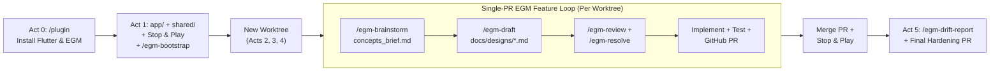

# Interactive Workshop: Building a Client/Server Agentic Markdown & A2UI Chat App with Flutter, Antigravity & EGM

Welcome! In this hands-on codelab, you will build **`flutter_agy_a2ui_chat`** from scratch using **Google Antigravity Desktop** (Antigravity 2.0), the **Antigravity Dart SDK** (`package:antigravity`), and the **Agent-to-UI (A2UI v1.0)** stack (`a2ui_core`, `a2ui_agent`, `a2ui_flutter`).

Because `package:antigravity` spawns the local Antigravity harness process (`localharness`) via `dart:io`, we will structure the repository as a **Dart pub workspace monorepo** with a clean client/server split:
- **`shared/`** (pure Dart): Shared domain models (`ChatThread`, `ChatMessage`, `ChatProject`, `PendingCommandReview`) and typed client↔server wire messages.
- **`app/`** (Flutter client): Cross-platform UI (runs on Web, Linux, macOS, or Windows with zero native OS process entitlements) powered by `flutter_markdown_plus` and `a2ui_flutter`.
- **`server/`** (Dart backend, added in Act 2): Lightweight WebSocket/HTTP server hosting `package:antigravity` (`localharness`) and `a2ui_agent`.

Rather than treating AI coding as a one-shot prompt lottery, we are going to practise **Spec-Driven Development (SDD)** using the **Elephant-Goldfish Model (EGM)** plugin and Antigravity Desktop's native **Git worktree** support:

- **Plugins First (`/plugin`)**: Before writing a line of Dart, we will equip our agent with the official **Dart and Flutter** plugin and the **Elephant-Goldfish Model (EGM)** plugin.
- **Stop & Play After Every Act**: Automated `flutter test` and `dart analyze` checks catch layout overflows and type errors, but they cannot tell you how an app *feels* in a live window. After every act, you will stop, run the app, and work through a human verification checklist of behaviours that unit tests cannot easily cover.
- **Document Baseline, Then Build via EGM Worktree PRs**: After building the initial `app/` + `shared/` workspace in Act 1, we will run `/egm-bootstrap` to generate a hierarchy of architectural `README.md` contracts. Every subsequent feature act (Acts 2–4) will run in an isolated **Antigravity Git worktree**, following the full EGM loop (`/egm-brainstorm` → `/egm-draft` → `/egm-review` → `/egm-resolve` → Implement → GitHub Pull Request).
- **Close the Loop with `/egm-drift-report` (Act 5)**: Finally, we will audit our specifications and `README.md` contracts against the finished monorepo to catch and resolve implementation drift.



---

## Act 0: Prerequisites, Workspace Scaffold & `/plugin` Exploration

### 0.1 — Prerequisites

Ensure you have the following installed and authenticated on your machine (Linux, macOS, or Windows):
- **Flutter SDK** (3.24+ / Dart 3.6+ with pub workspace support; verify with `flutter doctor`)
- **GitHub CLI (`gh`)** authenticated via `gh auth login` (so Antigravity can push worktree branches and open GitHub Pull Requests)
- **Google Antigravity Desktop** (Antigravity 2.0)

### 0.2 — Scaffold the Monorepo & GitHub Repository

In your terminal, create the root workspace folder, scaffold the `shared/` Dart package and `app/` Flutter client, link them in a root `pubspec.yaml` workspace, and push the initial commit to GitHub:

```bash
mkdir flutter_agy_a2ui_chat
cd flutter_agy_a2ui_chat

# Create the shared pure-Dart package and the Flutter UI app:
dart create -t package shared
flutter create app

# Create a root Dart pub workspace pubspec.yaml:
cat << 'EOF' > pubspec.yaml
name: flutter_agy_a2ui_chat_workspace
publish_to: none
environment:
  sdk: ^3.6.0
workspace:
  - shared
  - app
EOF

# Enable workspace resolution in child packages and resolve dependencies:
flutter pub get

# Initialize Git and push to a new GitHub repository for PR workflows:
git init -b main
git add .
git commit -m "Initial commit: Dart pub workspace with shared/ and app/"
git tag step-00-scaffold
gh repo create flutter_agy_a2ui_chat --private --source=. --remote=origin --push
```

> [!NOTE]
> If `dart create` and `flutter create` did not add `resolution: workspace` to `shared/pubspec.yaml` and `app/pubspec.yaml`, the agent will add `resolution: workspace` to both in Act 1 so dependencies resolve cleanly at the monorepo root.

Now open **Antigravity Desktop**, click **Projects → Add Project**, and select your `flutter_agy_a2ui_chat` root directory.

### 0.3 — Explore `/plugin` First: Install the Flutter & EGM Plugins

Before we ask the agent to build anything, let us make sure it has the right domain skills, subagents, MCP servers, and spec-driven workflows installed.

In the Antigravity Desktop chat input (or via the **Skills & Customizations** sidebar item on the left), run:

```text
/plugin
```

> [!IMPORTANT]
> **Install and enable both of these plugins before starting Act 1:**
> 1. **Dart and Flutter (`flutter`)** — Official plugin authored by the Dart and Flutter teams.
> 2. **Elephant-Goldfish Model (`egm`)** — Google's open-source Spec-Driven Development plugin (*"Design with an elephant. Review with a goldfish."*).

Take two minutes to expand both plugins in the Customizations panel and inspect what they bundle into your workspace:

| Plugin | What It Adds to Your Agent | Why It Matters for This Workshop |
| :--- | :--- | :--- |
| **Dart and Flutter** (`flutter`) | **25 Skills** (`flutter-apply-architecture-best-practices`, `flutter-add-widget-test`, `dart-run-static-analysis`, `flutter-fix-layout-issues`, `flutter-build-responsive-layout`, `dart-implement-json-serialization`, etc.), the **`flutter_a11y_agent`** subagent, hot-reload rules, and **`dart-mcp-server`**. | Gives the agent idiomatic layered Flutter architecture patterns, JSON serialisation best practices for `shared/`, and teaches it to run `dart analyze` and `flutter test` in its self-correction loop. |
| **Elephant-Goldfish Model** (`egm`) | **7 Skills** (`/egm-bootstrap`, `/egm-brainstorm`, `/egm-draft`, `/egm-review`, `/egm-resolve`, `/egm-review-loop`, `/egm-drift-report`) and **9 Subagent Personas** (`egm-design`, `egm-zoom-out`, `egm-comprehension`, `egm-codebase-details`, `egm-implementation-readiness`, `egm-style`, `egm-structural`, `egm-synthesizer`, `egm-bootstrap-orchestrator`). | Lets an **Elephant** (your main stateful session) draft specs while **Goldfish** (fresh-context subagents with zero conversation memory) stress-test your designs for blind spots before you write code. |

> [!TIP]
> If the **Elephant-Goldfish Model (`egm`)** plugin does not appear in your marketplace catalogue yet, you can ask the agent in chat:
> `Install https://github.com/google/elephant-goldfish-model`

---

## Act 1: Build the Initial Markdown Chat UI (`app/` + `shared/`) & Bootstrap EGM (`step-01-markdown-chat`)

In Act 1, we work in **Local Mode** on `main` to build the shared chat models in `shared/` and the responsive split-view Markdown chat UI in `app/` using `flutter_markdown_plus`, backed initially by a local simulated repository so we can test the UI immediately.

### 1.1 — Prompt: Build `shared/` Models & the `app/` Markdown Chat UI

Start a new conversation in **Local Mode** and send the following prompt:

```text
Please configure this Dart pub workspace (`shared/` and `app/`) and build a responsive Markdown chat application using `flutter_markdown_plus` with the following features:
1. In `shared/`, define immutable serialisable domain models (`ChatMessage`, `ChatThread`, `MessageSender`) with `toJson`/`fromJson` support and unit tests in `shared/test/`.
2. In `app/`, build a collapsible split-view conversation thread sidebar with per-thread typing state, automatic thread titling, and starter threads showcasing rich GitHub-Flavored Markdown (simulated locally in `ChatRepository` for now).
3. Markdown message rendering (headings, bold/italic/strikethrough, inline and fenced code blocks, blockquotes, lists, and GitHub-style tables) with a one-click Copy Markdown button on every message bubble.
4. A Markdown composer that restores focus after sending, with a formatting toolbar (Bold, Italic, Inline Code, Code Block, List, Blockquote), a live Markdown preview toggle, and keyboard shortcuts (`Enter` or `Numpad Enter` to send, `Shift + Enter` for a newline with an IME composition guard).
5. A responsive top toolbar with Light and Dark Material 3 theme switching.
6. Widget tests in `app/test/widget_test.dart` and workspace build/run instructions in `README.md`.
```

#### What to Watch While Antigravity Builds Act 1
- **Automatic Skill Consultation**: Watch the agent read `flutter-apply-architecture-best-practices`, `flutter-implement-json-serialization`, `flutter-add-widget-test`, and `dart-run-static-analysis` from the **Flutter plugin** you enabled in Act 0.
- **Clean Workspace Separation**:
  - **`shared/lib/src/models/chat_models.dart`**: Pure-Dart `ChatMessage`, `ChatThread`, and `MessageSender` models with `toJson` / `fromJson` ready for Act 2's client/server wire protocol.
  - **`app/lib/data/repositories/chat_repository.dart`**: Abstract/injectable repository interface with starter threads demonstrating GitHub-Flavored Markdown and simulated assistant replies.
  - **`app/lib/ui/`**: `ChatViewModel` (`ChangeNotifier`), `AppTheme`, `TopToolbar`, `ThreadSidebar`, `MessageBubble`, `MarkdownComposer`, and `ChatScreen`.
- **Self-Correction via Widget Tests**: When the agent runs `flutter test` inside `app/`, the default 800×600 test viewport catches subtle `RenderFlex` overflows in header rows when the sidebar is open—allowing the agent to fix its layout before you launch the app.

---

### 1.2 — Stop & Play: Act 1 Human Verification Checklist

Launch the Flutter client from `app/` in a terminal (you can target your native desktop OS or Chrome web, and leave this terminal running so you can hot-restart with `R`):

```bash
cd app
flutter run
```

Automated widget tests verify that widgets mount and callbacks fire, but they use a synthetic renderer and mocked clipboard/keyboard channels. **Test these real-world UI behaviours yourself:**

- [ ] **Window Resizing & Split-View Geometry**: Drag the window edge from narrow (~650px) to wide (~1600px) and toggle the sidebar collapse button in the top toolbar. Verify the 280px sidebar transitions smoothly without text clipping or layout jumps in the message list.
- [ ] **GitHub-Flavored Markdown Visual Fidelity (Light vs. Dark)**: Open the **Markdown Showcase** starter thread and toggle between **Light** and **Dark** Material 3 themes. Visually inspect table cell borders, inline `code` pill contrast, blockquote left borders, and fenced code block backgrounds in both colour schemes.
- [ ] **Real System Clipboard (`Copy Markdown`)**: Hover or click the **Copy Markdown** icon on a message bubble, verify the icon changes to a checkmark, and paste (`Ctrl+V` / `Cmd+V`) inside the composer or a text editor to confirm the raw Markdown source actually lands on your OS clipboard.
- [ ] **Physical Keyboard Shortcuts & IME Composition Guard**:
  - Type a line in the composer, press **`Shift+Enter`**, and confirm it inserts a newline rather than sending.
  - Press **`Enter`** (and **`Numpad Enter`** if you have a full keyboard) to confirm it sends the message and **immediately restores keyboard focus** to the composer so you can keep typing without clicking the mouse.
  - If you use an IME or dead-key compose sequence (e.g., composing accented or CJK characters), press `Enter` while the active composition underline is visible and confirm the IME composition guard prevents premature sending.
- [ ] **Formatting Toolbar Cursor Wrapping**: Highlight a word in the composer and click **Bold** (`**text**`) or **Code Block**, then toggle **Live Preview** to see the side-by-side rendered preview update as you type.
- [ ] **Independent Per-Thread Typing Timers**: Create two new threads, send a message in Thread A, and immediately switch to Thread B before the simulated reply arrives. Verify the typing indicator stays scoped to Thread A in the sidebar and doesn't bleed into Thread B's message list.

---

### 1.3 — Introduce EGM: Document the Baseline Monorepo with `/egm-bootstrap`

Now that our initial workspace (`shared/` and `app/`) works and passes human inspection, we want to prepare the repository for **Spec-Driven Development**.

When an AI agent (or a new human teammate) lands in a multi-package repository to design a feature, reading every `.dart` file from scratch wastes context tokens. EGM solves this with **Peanuts and Hay**:
- **Peanuts (Leaf `README.md`s)**: Component-level `README.md` files in each leaf directory (`shared/lib/src/models/`, `app/lib/data/repositories/`, `app/lib/ui/features/chat/view_models/`, etc.) documenting exact file contracts, public interfaces, invariants, and side effects.
- **Hay (Parent & Root `README.md`s)**: High-altitude architectural blueprints at package roots (`shared/README.md`, `app/README.md`) and the monorepo root (`README.md`) that roll up child contracts so agents can navigate the workspace top-down.

Run the EGM bootstrap skill across your repository:

```text
/egm-bootstrap .
```

#### What Happens During `/egm-bootstrap`
1. The root orchestrator maps your workspace directory tree level-by-level and identifies the test/analysis verification commands from `pubspec.yaml`.
2. It spawns parallel sub-orchestrator and Goldfish verification subagents (`egm-codebase-details`, `egm-comprehension`, `egm-style`, `egm-structural`) to generate and audit `README.md` contracts across `shared/` and `app/`, rolling them up into the root `README.md`.
3. Create the `docs/designs/` directory and `docs/designs/SITEMAP.md` index if not yet present so our upcoming feature specs have a home.

Once `/egm-bootstrap` finishes, review the generated `README.md` files in Antigravity Desktop's **Files Changed** pane, then ask the agent to commit, tag `step-01-markdown-chat`, and push to `main`:

```text
Please commit all changes, tag as step-01-markdown-chat, and push main to origin.
```

---

## How the EGM + Git Worktree PR Loop Works (Acts 2, 3 & 4)

From this point forward, **we will not code directly on `main`**. Every new feature act follows a disciplined 5-step engineering workflow in Antigravity Desktop:

1. **Start a New Conversation in `New Worktree` Mode**:
   - In Antigravity Desktop, click **New Conversation**.
   - In the workspace selector at the bottom of the prompt box, switch from **Local** to **New worktree**.
   - Antigravity automatically provisions an isolated Git worktree under `~/.gemini/antigravity/worktrees/flutter_agy_a2ui_chat/<feature-name>` on its own feature branch, leaving your primary `flutter_agy_a2ui_chat` checkout completely untouched.
2. **Ideate with `/egm-brainstorm` (Elephant + 6-Lens Goldfish Swarm)**:
   - Answer open-ended clarifying questions from the Elephant until the problem statement and constraints are sharp.
   - Let EGM spawn its 6 parallel Goldfish brainstorming lenses (*Contrarian/YAGNI*, *Cost/Quota*, *UX/Ergonomics*, *Migration*, *Observability*, *Tech Debt*) to challenge your assumptions and write `concepts_brief.md`.
3. **Specify with `/egm-draft` (Section-by-Section Design Doc)**:
   - Turn `concepts_brief.md` into a formal design specification (`Overview & Goals`, `Technical Plan`, `Alternatives Considered`, `Detailed Implementation`), approving each section interactively and saving the final spec to `docs/designs/<feature>.md` (and `docs/designs/SITEMAP.md`).
4. **Audit with `/egm-review` & `/egm-resolve` (Fresh-Context Goldfish Review)**:
   - Run `/egm-review docs/designs/<feature>.md` so fresh-context Goldfish subagents verify your spec against the workspace packages and their bootstrapped `README.md` contracts.
   - Run `/egm-resolve` to apply `PROPOSE FIX` improvements and resolve any `ESCALATE` trade-offs.
5. **Implement, Open a GitHub PR & Stop & Play**:
   - Ask the Elephant to implement `docs/designs/<feature>.md`, update affected component `README.md` contracts (and bootstrap `server/` when added), verify `dart format . && dart analyze && dart test` / `flutter test`, and open a GitHub Pull Request containing both the design doc and the implementation.
   - Merge the PR into `main`, pull `main` in your primary checkout, and **Stop & Play**!

---

## Act 2: Add the `server/` Package & Integrate `package:antigravity` (`step-02-antigravity-sdk`)

In Act 2, we introduce the **`server/`** package into our Dart pub workspace to host the **Google Antigravity Dart SDK** (`package:antigravity` / `localharness`) and stream live responses over a WebSocket connection using typed protocol envelopes in **`shared/`**.

### 2.1 — Start a New Worktree & Run `/egm-brainstorm`

Click **New Conversation**, select **New worktree**, and start brainstorming:

```text
/egm-brainstorm Let's add a `server/` pure-Dart backend package to this workspace that integrates `package:antigravity` (`localharness`) and streams assistant responses to the `app/` Flutter client over WebSockets using shared protocol classes in `shared/`. We need per-thread session management, mid-stream cancellation, connection status feedback in the UI, and fast deterministic tests for both `server/` and `app/` without spawning real OS processes in unit/widget tests.
```

#### Key Architectural Decisions & Trade-offs to Discuss with the Elephant
As the Elephant drills into the problem and inspects `package:antigravity` (and the bootstrapped `README.md` files from Act 1), guide the discussion around these three seamlines:
1. **Why `server/` Owns `package:antigravity`**:
   - `package:antigravity`'s `LocalConnectionStrategy` uses `dart:io` `Process.start` to spawn `~/.antigravity/bin/localharness` and reads local environment variables (`GEMINI_API_KEY`).
   - Running `package:antigravity` inside a dedicated pure-Dart `server/` (`package:shelf` + `package:shelf_web_socket`) means `app/` needs zero OS subprocess entitlements and works identically across Desktop, Web, and Mobile!
2. **Typed Client↔Server Wire Protocol in `shared/`**:
   - Define sealed/tagged JSON message classes in `shared/lib/src/protocol/` Using Dart 3 pattern matching (`dart-use-pattern-matching` skill):
     - **Client → Server**: `SendPromptRequest(threadId, requestId, prompt, threadTitle)`, `CancelRequest(threadId, requestId)`, `CloseThreadSessionRequest(threadId)`.
     - **Server → Client**: `StreamChunkEvent(threadId, requestId, textDelta)`, `StreamDoneEvent(threadId, requestId)`, `StreamErrorEvent(threadId, requestId, message)`.
3. **The `FakeAsync` Testability Seam**:
   - Inside `package:antigravity`, `ChatResponse.chunks` polls internally with `Future.delayed(const Duration(milliseconds: 5))` and `Agent.start()` spawns a real OS process.
   - On `server/`, wrap `Agent` behind an injectable `AntigravityAgentSession` interface so `server/test/` can test WebSocket multiplexing and cancellation against a fake session. On `app/`, inject a WebSocket channel/transport factory into `ChatRepository` so `app/test/widget_test.dart` runs deterministically in `FakeAsync`.

Once you approve the working hypothesis and the 6-lens Goldfish brainstorm review completes, review the generated `concepts_brief.md`.

### 2.2 — Draft the Specification (`/egm-draft`)

Run:

```text
/egm-draft
```

Step through the 4 interactive approval gates (`Overview & Goals`, `Technical Plan`, `Alternatives Considered`, `Detailed Implementation`) and save the finalized specification to **`docs/designs/client_server_antigravity_sdk.md`**.

### 2.3 — Goldfish Review & Resolution (`/egm-review` & `/egm-resolve`)

Stress-test the design doc with fresh-context Goldfish subagents:

```text
/egm-review docs/designs/client_server_antigravity_sdk.md
```

When the review completes, resolve the surfaced findings in `goldfish_review_report.md`:

```text
/egm-resolve
```

### 2.4 — Implement, Verify & Create the GitHub PR

Once your specification in `docs/designs/client_server_antigravity_sdk.md` is approved, prompt the agent to build it and open the Pull Request:

```text
Please implement the approved specification in `docs/designs/client_server_antigravity_sdk.md`:
1. Create the `server/` package (`bin/server.dart` and `lib/`), register `server` in the root `pubspec.yaml` workspace, and add `antigravity`, `shelf`, and `shelf_web_socket`.
2. Add the typed client↔server wire protocol classes in `shared/` and connect `app/`'s `ChatRepository` and `ChatViewModel` over `web_socket_channel` (including a server connection indicator in `TopToolbar`).
3. Add unit tests in `shared/test/` and `server/test/`, update widget tests in `app/test/widget_test.dart`, and document `server/` and updated contracts with `README.md` files.
4. Verify `dart format . && dart analyze` and all tests in `shared/`, `server/`, and `app/` pass, then commit, push, and create a GitHub Pull Request with `gh pr create`.
```

Review the Pull Request on GitHub (or via `gh pr view`), merge it (`gh pr merge --merge --delete-branch`), and in your main checkout terminal pull `main`, resolve workspace dependencies, and tag the milestone:

```bash
git pull origin main
flutter pub get
git tag step-02-antigravity-sdk
```

---

### 2.5 — Stop & Play: Act 2 Human Verification Checklist

Start the Dart backend server in **Terminal 1**:

```bash
dart run server/bin/server.dart
```

And in **Terminal 2**, hot-restart (`R`) or run your Flutter client (`cd app && flutter run`). Then work through this human verification checklist:

- [ ] **Server Connection Indicator & Live Reconnect**: Verify the top toolbar in `app/` shows a connected status badge for the local Dart server (`ws://localhost:8080/ws`). Stop `server.dart` (`Ctrl+C`) in Terminal 1, observe the disconnected/reconnecting indicator (or clean error alert when sending a message), restart `server.dart`, and confirm the client reconnects cleanly.
- [ ] **Live Token-by-Token Streaming Cadence**: Create a new thread (`+`) and send: *"Explain in 3 short paragraphs why a client/server split is great for AI agent UIs."* Watch the assistant bubble grow token-by-token as `localharness` → `server/` → `app/` streams `StreamChunkEvent`s over the WebSocket, verifying smooth scroll tracking without layout jitter.
- [ ] **Multi-Turn Session Memory Within a Thread**: Send a follow-up prompt in the *same* thread: *"Now summarise your second point in one haiku."* Confirm the agent remembers the previous turn's context because `server/` reuses that thread's `AntigravityAgentSession`.
- [ ] **Cross-Thread Context Isolation**: Click `+` to create a second thread and ask: *"What did we just talk about?"* Confirm the new thread starts a fresh `Agent` session on `server/` with zero memory of the first thread.
- [ ] **Background Streaming While Switching Threads**: Ask a long question in Thread 1 (*"Write a comprehensive comparison of state management approaches with a Markdown table"*), immediately click over to Thread 2 while Thread 1 is still streaming, watch Thread 1's typing badge animate in the sidebar, and switch back to confirm the streamed Markdown table completed cleanly.
- [ ] **Mid-Stream Cancellation / Thread Deletion**: Start a long streaming response in a throwaway thread and click the trash icon to delete that thread mid-stream. Verify `app/` sends `CancelRequest` / `CloseThreadSessionRequest` to `server/` and no ghost tokens leak into other threads.

---

## Act 3: Project Workspaces (`CWD`) & Remote Sandbox Escape Review UI (`step-03-projects-sandbox`)

In Act 3, we examine how `server/` configures the working directory (`CWD`) and sandbox policies for `localharness`, and we use the EGM workflow to build **Project Workspaces (`CWD`)** and a real-time **Human-in-the-Loop Sandbox Escape Review** flow over the WebSocket between `server/` and `app/`.

### 3.1 — Start a New Worktree & Investigate `server/` Working Directory & State Isolation

Click **New Conversation**, switch to **New worktree**, and start with an investigative prompt before launching `/egm-brainstorm`:

```text
Please review `server/`, `shared/`, `app/`, and `package:antigravity`. Which directory does `server/` give the Antigravity `localharness` as its initial working directory, and how does `package:antigravity` enforce workspace containment versus command sandboxing? Also note any state isolation issues you spot in the current chat UI.
```

#### What the Agent Discovers
1. **Hardcoded / Implicit Server `CWD`**:
   - If `server/` passes `workspaces: null` to `LocalAgentConfig`, `localharness` defaults to whatever directory `dart run server/bin/server.dart` was launched from (`Directory.current`). The user in `app/` has no visibility into—or control over—which local repository `localharness` is operating on!
2. **`workspaceOnly` vs. `RunCommandConfig(enableSandbox: true)`**:
   - In `package:antigravity`, `PolicyConfig.workspaceOnly` **only** confines file tools (`view_file`, `write_to_file`, `file_edit`, `find`, `grep_search`, `list_dir`) to the workspace—it does **not** by itself enable sandboxing on `run_command`!
   - To sandbox shell commands and intercept escapes, `server/` must combine **`CapabilitiesConfig(runCommand: RunCommandConfig(enableSandbox: true))`** with a layered policy (`workspaceOnly` + `askUser(BuiltinTools.runCommand.value, predicate: isSandboxEscapeToolCall, handler: ...)` + `auto` + `allowAll`).
3. **Two UI State-Isolation Catches**:
   - **Shared Composer Draft Across Threads**: `MarkdownComposer` uses a single `TextEditingController`, so typing an unsent draft in Thread A leaks into Thread B when you switch threads.
   - **Thread Title & Project `CWD` Locked at Session Creation**: Renaming a thread or changing its project working directory must notify `server/` to recreate the thread's `AntigravityAgentSession`.

### 3.2 — Brainstorm & Stress-Test the Design (`/egm-brainstorm`)

Now launch `/egm-brainstorm` in the same worktree conversation to design the solution across `shared/`, `server/`, and `app/`:

```text
/egm-brainstorm Let's design and build:
1. Project Workspaces (`ChatProject`): Group threads by Project in `shared/`, `app/`, and `server/`, where each Project defines an explicit `workingDirectory` (`CWD`) for `localharness` (plus a server endpoint/message to suggest or validate workspace directory presets).
2. Remote Human-in-the-Loop Sandbox Escape Review: Enable `RunCommandConfig(enableSandbox: true)` on `server/`. When `localharness` invokes `run_command` with `BypassSandbox: true` or references a path outside the Project's `workingDirectory`, `server/` pauses the policy handler on a `Completer<bool>`, emits a `CommandReviewRequiredEvent` over the WebSocket to `app/`, displays an amber Sandbox Escape Review banner with Deny and Approve & Run buttons, and resolves the `Completer<bool>` when `app/` sends back `CommandReviewDecisionRequest`.
3. Per-thread unsent composer draft isolation in `app/` and session refresh on `server/` when a thread's title or project `workingDirectory` changes.
```

### 3.3 — Draft, Review, Resolve & Implement (`/egm-draft` → `/egm-review` → PR)

1. **Draft the Spec**:
   ```text
   /egm-draft
   ```
   Save the approved design to **`docs/designs/project_workspaces_and_sandbox_review.md`**.
2. **Run the Goldfish Review & Resolution**:
   ```text
   /egm-review docs/designs/project_workspaces_and_sandbox_review.md
   ```
   Followed by:
   ```text
   /egm-resolve
   ```
3. **Implement, Test & Open the GitHub PR**:
   ```text
   Please implement the approved specification in `docs/designs/project_workspaces_and_sandbox_review.md` across `shared/`, `server/`, and `app/`, update the relevant component `README.md` contracts and `docs/designs/SITEMAP.md`, verify `dart format . && dart analyze` and all tests in `shared/`, `server/`, and `app/` pass, and open a GitHub Pull Request for this worktree branch.
   ```

Merge the Pull Request into `main`, pull `main` in your primary checkout, and tag `step-03-projects-sandbox`:

```bash
git pull origin main
git tag step-03-projects-sandbox
```

---

### 3.4 — Stop & Play: Act 3 Human Verification Checklist

Restart `dart run server/bin/server.dart` in Terminal 1 and press **`R`** (Hot Restart) in your running `flutter run` client in Terminal 2.

Test these interactive client/server behaviours that automated tests cannot substitute for:

- [ ] **Project Switcher & Directory Presets**: Click the Project selector in the sidebar (or top toolbar), open the **New Project** dialog, test the quick-pick directory chips (Workspace, Home, Temp), and verify that switching projects filters the thread list and updates the active `CWD` badge in the top toolbar.
- [ ] **Per-Thread Unsent Composer Draft Isolation**: Type `"Draft message for Thread A — do not send"` into the composer in Thread A. Click Thread B in the sidebar and confirm the composer is empty. Type `"Different draft in Thread B"`, switch back to Thread A, and verify your original unsent text is still waiting for you.
- [ ] **In-Sandbox Auto-Approval on `server/` (Happy Path)**: In a thread scoped to your `flutter_agy_a2ui_chat` project directory, ask the agent:
  ```text
  Please list the files in this project root directory and tell me what packages are in this workspace.
  ```
  Verify the command executes inside `server/`'s `localharness` sandbox **without** popping up a review banner in `app/`, because the command stays inside the project workspace.
- [ ] **Live Client↔Server Sandbox Escape Review (`Deny` vs. `Approve & Run`)**: Now ask the agent to run a shell command targeting a directory outside the workspace:
  ```text
  Please run a shell command to list the files in my parent directory `..` (or the system temp directory).
  ```
  - Watch `server/` intercept the tool call, emit `CommandReviewRequiredEvent` over the WebSocket, and render the amber **Sandbox Escape Review** banner at the top of the thread in `app/` while `server/`'s policy handler stays suspended on its `Completer<bool>`!
  - Inspect the displayed command line, the project workspace directory, and the human-readable escape reason (e.g., `References path outside workspace` or `Requests BypassSandbox=true`).
  - First click **Deny** in `app/` and watch `server/` reject the tool call and stream the agent's response acknowledging the denial.
  - Ask again, click **Approve & Run**, and verify `server/` completes the tool call and streams the directory listing back into the chat.

---

## Act 4: Interactive Agent-to-UI Surfaces with A2UI v1.0 (`step-04-a2ui`)

Markdown is great for prose, tables, and code blocks, but when an agent needs to collect structured parameters or present interactive controls, static text forces a clunky back-and-forth guessing game.

In Act 4, our client/server split shines: we integrate **A2UI v1.0** (`a2ui_core`, `a2ui_agent`, `a2ui_flutter`) across `shared/`, `server/`, and `app/` so the agent can stream live, reactive Flutter UI surfaces inline alongside Markdown and execute bidirectional RPCs.

### 4.1 — Start a New Worktree & Explore the A2UI Package Seamlines

Click **New Conversation**, choose **New worktree**, and start by asking the Elephant to research how the three A2UI packages map onto our `shared/`, `server/`, and `app/` monorepo packages:

```text
Please research `a2ui_core`, `a2ui_agent`, and `a2ui_flutter` (in pub.dev / `.pub-cache`). Explain the architectural seamlines between the three packages and how they map onto our `shared/`, `server/`, and `app/` workspace packages.
```

#### How the 3 A2UI Packages Map to Our Monorepo
- **`a2ui_core` (Pure Dart — Shared Protocol, State & Expression Engine)**: Used in `shared/`, `server/`, and `app/`. Owns wire messages (`AgentToRendererMessage` / `RendererToAgentMessage`), `Catalog<T, F>`, `MessageProcessor<T>`, `SurfaceGroupModel<T>`, `SurfaceModel<T>`, `DataModel`, and `NodeResolver<T>` backed by `preact_signals`.
- **`a2ui_agent` (Pure Dart — Prompting, Stream Parsing & JSON Healing)**: Used in `server/` (and/or `app/`'s stream processor). Owns `A2uiGenerator` (system prompt schema injection for `localharness`), `DirectJsonFormatFactory` (streaming `<a2ui-json>` parser & JSON healer), `RendererState`, and `StreamedAnswer<T>`.
- **`a2ui_flutter` (Flutter SDK — Widget Builders & Reactive `A2uiSurface`)**: Used exclusively in `app/`. Owns `ComponentImplementation` (`ComponentProps` → `Widget`), `basicCatalog()`, `A2uiSurface`, `NodeView`, and `A2uiMarkdown`.

### 4.2 — Brainstorm the A2UI v1.0 Integration (`/egm-brainstorm`)

Launch `/egm-brainstorm` in your worktree session to scope our A2UI v1.0 capabilities across the client/server boundary:

```text
/egm-brainstorm Let's integrate `a2ui_core`, `a2ui_agent`, and `a2ui_flutter` (A2UI v1.0) across `shared/`, `server/`, and `app/` with three capabilities:
1. Inline Streaming A2UI v1.0 Surfaces: Inject the A2UI v1.0 catalog prompt schema via `A2uiGenerator` on `server/`, and parse streamed `<a2ui-json>` blocks via `StreamedAnswer` and `MessageProcessor` so `createSurface`, `updateComponents`, `updateDataModel`, and `deleteSurface` messages render reactive `A2uiSurface` cards inline inside `MessageBubble` in `app/` (and strip raw `<a2ui-json>` tags from sidebar thread previews).
2. Bidirectional Renderer & Workspace RPC Functions (`FunctionImplementation`): Extend `basicCatalog()` with custom functions (`getWorkspaceInfo`, `listWorkspaceFiles`, `setSurfaceData`, and `formatParameterSummary`), where workspace inspection functions query the active Project's workspace via `server/` and local data/formatting functions execute reactively in `app/`.
3. Interactive Clarifying Parameter Forms & Two-Way Actions: Add quick-prompt chips and builders showcasing `Card`, `TextField` (with `required` validation), `ChoicePicker` (`mutuallyExclusive` and `multipleSelection`), `Slider`, `CheckBox`, a live reactive `formatParameterSummary` preview, a local `Use Audit Preset` button calling `setSurfaceData`, and wire `onAction` / `outboundListener` so `RendererToAgentMessage` payloads + `a2uiRendererDataModel` can be sent over the WebSocket to `server/`.
```

#### Three Classic A2UI v1.0 Pitfalls to Capture in Your Spec
Make sure your `concepts_brief.md` and `docs/designs/a2ui_interactive_surfaces.md` explicitly call out these three nuances so neither the agent nor future maintainers trip over them:
1. **A2UI v1.0 `Text.variant` Schema Restriction**: Unlike v0.8 (which allowed `'h5'`), `BasicCatalog.v1_0` restricts `Text.variant` to `'caption'` or `'body'`. Using `'h5'` causes `PayloadValidator` to reject the `updateComponents` payload—use `variant: 'body'` with Markdown headings (`### Heading`) instead.
2. **No Unclosed Literal `` `<a2ui-json>` `` Tokens in Prose**: `a2ui_agent`'s `DirectJsonParser` intentionally strips surrounding backticks around `` `<a2ui-json>` `` to tolerate LLMs that wrap tags in inline code. Mentioning a literal unclosed `` `<a2ui-json>` `` token in prose before the real block opens the JSON parser prematurely inside the sentence!
3. **`A2uiMarkdown` Gesture & Width Inside `OutlinedButton`**: Wrapping `A2uiSurface` with `A2uiMarkdown` renders `Button` child `Text` labels via `MarkdownBody`. You must configure `MarkdownBody` inside `A2uiMarkdown` with `selectable: false` and `fitContent: true` so it does not stretch full-width or swallow pointer taps meant for `OutlinedButton.onPressed`.

### 4.3 — Draft, Review, Resolve & Implement (`/egm-draft` → `/egm-review` → PR)

1. **Draft the Specification**:
   ```text
   /egm-draft
   ```
   Save the finalized design to **`docs/designs/a2ui_interactive_surfaces.md`**.
2. **Run the Goldfish Review & Resolution**:
   ```text
   /egm-review docs/designs/a2ui_interactive_surfaces.md
   ```
   Followed by:
   ```text
   /egm-resolve
   ```
3. **Implement, Test & Open the GitHub PR**:
   ```text
   Please implement the approved specification in `docs/designs/a2ui_interactive_surfaces.md` across `shared/`, `server/`, and `app/`:
   1. Add `a2ui_core`, `a2ui_agent`, and `a2ui_flutter` to the appropriate workspace packages.
   2. Implement the custom `FunctionImplementation`s and wire `A2uiGenerator`, `StreamedAnswer`, `MessageProcessor`, and inline `A2uiSurface` rendering across `server/` and `app/`.
   3. Add unit and widget tests across `shared/test/`, `server/test/`, and `app/test/widget_test.dart`, update component `README.md` contracts and `docs/designs/SITEMAP.md`, verify `dart format . && dart analyze` and all package tests pass, and open a GitHub Pull Request.
   ```

Merge the Pull Request into `main`, pull `main` in your primary checkout, run `flutter pub get`, and tag `step-04-a2ui`:

```bash
git pull origin main
flutter pub get
git tag step-04-a2ui
```

---

### 4.4 — Stop & Play: Act 4 Human Verification Checklist

Restart `dart run server/bin/server.dart` in Terminal 1 and press **`R`** (Hot Restart) in your running `flutter run` client in Terminal 2 (or re-run `flutter run` after `flutter pub get`) to test the interactive A2UI surfaces first-hand:

- [ ] **Starter Thread Inline A2UI Surface**: Open the **A2UI Surface Showcase** starter thread and confirm the interactive `A2uiSurface` card renders cleanly below the Markdown prose, while the thread preview snippet in the left sidebar strips out the raw `<a2ui-json>` tags.
- [ ] **Clarifying Parameter Form & Reactive Expression Binding**: Click the **Clarifying parameter form** quick-prompt chip above the composer (or ask for one):
  - Clear the **Target Path / Package Scope** `TextField` and verify the red required-validation message appears and disables/gates the **Submit Parameters** button.
  - Toggle the **Focus Area** single-select `ChoicePicker` chips, check/uncheck **Checks to Run** multi-select checkboxes, drag the **Concurrency** `Slider`, and toggle the **Sandboxed** `CheckBox`—watching the **Live Summary** text (`@call: "formatParameterSummary"`) recompute instantaneously on every pointer event via `preact_signals` without a server or LLM round-trip!
  - Click **Use Audit Preset** (`@call: "setSurfaceData"`) and verify all form controls snap to the preset values immediately.
- [ ] **Bidirectional Renderer RPC Inspection**: Click the **Run workspace RPC function** quick-prompt chip to watch the surface invoke `getWorkspaceInfo` and `listWorkspaceFiles` against your active `ChatProject` workspace.
- [ ] **Live A2UI Surface Prompt (And a Cliffhanger!)**: Create a new thread and ask the live agent:
  ```text
  Please ask me a multiple choice computer science trivia question using an interactive A2UI v1.0 surface with a ChoicePicker and a Submit Answer button.
  ```
  - Watch the live `<a2ui-json>` surface stream from `server/` to `app/` and materialize progressively (`DirectJsonFormatFactory` healing partial JSON as chunks arrive).
  - Select an answer in the `ChoicePicker` and click **Submit Answer**.
  - **Look closely at what happens when you click the button**: Depending on how `ChatViewModel` was wired for unit test determinism vs. live app defaults, does clicking **Submit Answer** record the action locally, or does it automatically dispatch the `ActionMessage` + `a2uiRendererDataModel` over the WebSocket to `server/`? And what happens if a single streaming response emits *two* `callRendererFunction` RPC calls back-to-back? Let us use `/egm-drift-report` in Act 5 to find out!

---

## Act 5: Detecting & Resolving Drift with `/egm-drift-report` (`step-05-fixup`)

In any multi-package client/server repository, subtle gaps can open up between what the design documents in `docs/designs/` promised, what the package `README.md` contracts claim, and how `shared/`, `server/`, and `app/` actually behave together at runtime.

Instead of guessing where those gaps are, we will start one final **New Worktree** session in Antigravity Desktop and run EGM's **`/egm-drift-report`** skill alongside a holistic workspace audit.

### 5.1 — Start a New Worktree & Run `/egm-drift-report`

Click **New Conversation**, select **New worktree**, and run:

```text
/egm-drift-report docs/designs/
```

Once `/egm-drift-report` generates `{YYYY-MM-DD}_DRIFT_REPORT.md` comparing `docs/designs/*.md` against `shared/`, `server/`, and `app/`, follow up in the same session to audit the component `README.md` contracts and check for any live client↔server edge cases:

```text
Please also check our component `README.md` files across `shared/`, `server/`, and `app/` for drift, and review the full workspace for any live-runtime edge cases around two-way A2UI action/RPC forwarding over the WebSocket, multi-RPC stream batching, thread auto-titling, and sandbox-escape path heuristics.
```

#### Classic Drift & Edge-Case Findings Surfaced in Act 5
1. **Two-Way A2UI Action & Outbound RPC Forwarding Disabled in `app/lib/main.dart`**:
   - If `ChatViewModel` defaulted `forwardSurfaceActionsToAgent: false` and `forwardRpcMessagesToAgent: false` to keep widget tests manual—and `app/lib/main.dart` instantiated `ChatViewModel()` without enabling them—clicking an `A2uiSurface` button in the live client only recorded the action locally instead of sending the `ActionMessage` + `a2uiRendererDataModel` over the WebSocket to `server/` as specified in the Act 4 design!
2. **Stream Self-Cancellation on Multi-RPC Turns**:
   - When `forwardRpcMessagesToAgent: true` is enabled and a single `<a2ui-json>` block triggers two `callRendererFunction` calls (such as `getWorkspaceInfo` + `listWorkspaceFiles`), synchronously starting a new agent turn inside `outboundListener` while `StreamedAnswer.feed(chunk)` is still mid-stream cancels the active stream! Outbound RPC responses emitted while a stream is active must be queued and flushed together as a single batched `RendererToAgentMessagePayload` turn once `StreamDoneEvent` arrives.
3. **Custom Thread Titles Overwritten on First Prompt**:
   - If a user renames a new empty thread before sending their first message, `shouldAutoTitle` must check `!current.isAutoTitled` so it never overwrites a user's custom title.
4. **Sandbox-Escape Path Heuristics Edge Cases on `server/`**:
   - `findOutsideWorkspacePathInCommand` on `server/` should catch `--flag=/outside/path`, `KEY=/outside/path`, environment variable expansions (`$HOME`, `$TMPDIR`), and `subdir/../..` escapes, while avoiding false positives on single-segment `awk '/pattern/'` regex literals.
5. **Bounded Workspace File Scans**:
   - `ListWorkspaceFilesFunction` should bound `directory.listSync()` (e.g., `maxScannedEntries = 1000`) and check `cancellationSignal?.isCancelled`.

### 5.2 — Reconcile the Codebase & Documentation, Re-Verify Drift & Open the Final PR

Prompt the agent to fix all surfaced code and documentation discrepancies and re-run `/egm-drift-report` until zero drift remains:

```text
Please reconcile all findings from the drift report and workspace review:
1. Enable `forwardSurfaceActionsToAgent: true` and `forwardRpcMessagesToAgent: true` in `app/lib/main.dart` and batch outbound RPC responses emitted during streaming so they flush together on stream completion over the WebSocket to `server/`.
2. Fix any thread auto-titling, sandbox path heuristic, and bounded directory scan edge cases, and add unit/widget regression tests in `shared/test/`, `server/test/`, and `app/test/widget_test.dart`.
3. Update `docs/designs/*.md` and all directory `README.md` contracts across `shared/`, `server/`, and `app/` so the documentation and implementation match 100%, then re-run `/egm-drift-report docs/designs/` to confirm "No drift detected."
4. Commit all changes, push this worktree branch, and open a GitHub Pull Request.
```

Merge the final Pull Request on GitHub, pull `main` in your primary checkout, and tag `step-05-fixup`:

```bash
git pull origin main
git tag step-05-fixup
```

---

### 5.3 — Stop & Play: Final End-to-End Live Verification (`step-05-fixup`)

Ensure `dart run server/bin/server.dart` is running in Terminal 1, press **`R`** (Hot Restart) in your running `flutter run` client in Terminal 2, and run this 3-turn live verification conversation:

- [ ] **Turn 1 — Live A2UI v1.0 Trivia Surface Generation**:
  - Create a new thread (`+`) and send:
    ```text
    Please ask a multiple choice question
    ```
  - Verify `server/` streams a Markdown heading followed by an inline `<a2ui-json>` v1.0 surface containing a `Card`, a `ChoicePicker` (`variant: "mutuallyExclusive"`), and a **Submit Answer** `Button` gated by `@call: "required"`.
- [ ] **Turn 2 — Automatic Two-Way A2UI Action & DataModel Round-Trip (`app/` → `server/` → `localharness`)**:
  - Click your chosen option in the `ChoicePicker` and click **Submit Answer**.
  - Verify that **without typing anything in the composer**, clicking the surface button in `app/` automatically sends the `ActionMessage` and `a2uiRendererDataModel` JSON payload over the WebSocket to `server/`, which forwards it to `localharness` and streams back a reply grading your answer!
- [ ] **Turn 3 — Sandboxed Workspace Inspection + Live Clarifying Parameter Form**:
  - In the same thread, send:
    ```text
    Please review this codebase
    ```
  - Watch `server/`'s `localharness` run in-workspace file/shell inspection commands inside the sandbox (auto-approved because they stay inside your active Project's `CWD`), summarise the `shared/`, `server/`, and `app/` architecture using your EGM `README.md` hierarchy, and emit an interactive A2UI clarifying parameter form to scope the review.

---

## Appendix: Switching Between Tagged Milestones

Each milestone is tagged on `main` so you can check out any stage of the workshop:

| Git Tag | Act | Workspace Packages | What to Explore in Stop & Play |
| :--- | :---: | :--- | :--- |
| `step-00-scaffold` | Act 0 | `shared/`, `app/` | Initial Dart pub workspace scaffold + `/plugin` setup (`flutter` & `egm`) |
| `step-01-markdown-chat` | Act 1 | `shared/`, `app/` | Split-view Markdown chat UI (`flutter_markdown_plus`), simulated replies, and `/egm-bootstrap` `README.md` hierarchy |
| `step-02-antigravity-sdk` | Act 2 | `shared/`, `server/`, `app/` | Dart WebSocket backend (`server/`) hosting `package:antigravity` (`localharness`) with live streaming to `app/` |
| `step-03-projects-sandbox` | Act 3 | `shared/`, `server/`, `app/` | Project workspaces (`CWD`), per-thread composer drafts, and remote human-in-the-loop Sandbox Escape Review over WebSocket |
| `step-04-a2ui` | Act 4 | `shared/`, `server/`, `app/` | Inline streaming `<a2ui-json>` v1.0 surfaces, interactive clarifying parameter forms, and bidirectional RPCs |
| `step-05-fixup` | Act 5 | `shared/`, `server/`, `app/` | Reconciled `/egm-drift-report`, automatic two-way A2UI action & batched RPC forwarding, and hardened sandbox path heuristics |
