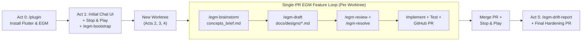

# Interactive Workshop: Building an Agentic Markdown & A2UI Chat App with Flutter, Antigravity & EGM

Welcome! In this hands-on codelab, you will build **`flutter_agy_a2ui_chat`** from scratch using **Google Antigravity Desktop** (Antigravity 2.0), the **Antigravity Dart SDK** (`package:antigravity`), and the **Agent-to-UI (A2UI v1.0)** stack (`a2ui_core`, `a2ui_agent`, `a2ui_flutter`).

Rather than treating AI coding as a one-shot prompt lottery, we are going to practise **Spec-Driven Development (SDD)** using the **Elephant-Goldfish Model (EGM)** plugin and Antigravity Desktop's native **Git worktree** support:

- **Plugins First (`/plugin`)**: Before writing a line of Dart, we will equip our agent with the official **Dart and Flutter** plugin and the **Elephant-Goldfish Model (EGM)** plugin.
- **Stop & Play After Every Act**: Automated `flutter test` and `dart analyze` checks catch layout overflows and type errors, but they cannot tell you how an app *feels* in a live window. After every act, you will stop, run the desktop app, and work through a human verification checklist of behaviours that unit tests cannot easily cover.
- **Document Baseline, Then Build via EGM Worktree PRs**: After building the initial app in Act 1, we will run `/egm-bootstrap` to generate a hierarchy of architectural `README.md` contracts. Every subsequent feature act (Acts 2–4) will run in an isolated **Antigravity Git worktree**, following the full EGM loop (`/egm-brainstorm` → `/egm-draft` → `/egm-review` → `/egm-resolve` → Implement → GitHub Pull Request).
- **Close the Loop with `/egm-drift-report` (Act 5)**: Finally, we will audit our specifications and `README.md` contracts against the finished codebase to catch and resolve implementation drift.



---

## Act 0: Prerequisites, Scaffold & `/plugin` Exploration

### 0.1 — Prerequisites

Ensure you have the following installed and authenticated on your machine (Linux, macOS, or Windows — anywhere the Antigravity SDK runs):
- **Flutter SDK** (3.24+ with desktop support enabled for your OS; verify with `flutter doctor`)
- **Native Desktop Toolchain** for your platform (Clang/GTK3 on Linux, Xcode on macOS, or Visual Studio C++ desktop workload on Windows)
- **GitHub CLI (`gh`)** authenticated via `gh auth login` (so Antigravity can push worktree branches and open GitHub Pull Requests)
- **Google Antigravity Desktop** (Antigravity 2.0)

### 0.2 — Scaffold the Project & GitHub Repository

In your terminal, create a brand-new desktop Flutter project, make the initial commit, and push it to a new GitHub repository so that your worktrees have an `origin` remote to open Pull Requests against:

```bash
flutter create flutter_agy_a2ui_chat --platforms=linux,macos,windows
cd flutter_agy_a2ui_chat
git init -b main
git add .
git commit -m "Initial commit: Flutter desktop scaffold"
git tag step-00-scaffold

# Create a private or public GitHub repo and push main:
gh repo create flutter_agy_a2ui_chat --private --source=. --remote=origin --push
```

Now open **Antigravity Desktop**, click **Projects → Add Project**, and select your `flutter_agy_a2ui_chat` directory.

### 0.3 — Explore `/plugin` First: Install the Flutter & EGM Plugins

Before we ask the agent to build anything, let us make sure it has the right domain skills, subagents, MCP servers, and spec-driven workflows installed.

In the Antigravity Desktop chat input (or via the **Skills & Customizations** sidebar item on the left), run:

```text
/plugin
```

> [!IMPORTANT]
> **Install and enable both of these plugins before starting Act 1:**
> 1. **Dart and Flutter (`flutter`)** — Official plugin authored by the Dart and Flutter teams.
> 2. **Elephant-Goldfish Model (`egm`)** — Google's open-source Spec-Driven Development plugin (*"Design with an elephant. Review with a goldfish."*).

Take two minutes to expand both plugins in the Customizations panel and inspect what they bundle into your workspace:

| Plugin | What It Adds to Your Agent | Why It Matters for This Workshop |
| :--- | :--- | :--- |
| **Dart and Flutter** (`flutter`) | **25 Skills** (`flutter-apply-architecture-best-practices`, `flutter-add-widget-test`, `dart-run-static-analysis`, `flutter-fix-layout-issues`, `flutter-build-responsive-layout`, etc.), the **`flutter_a11y_agent`** subagent, hot-reload rules, and **`dart-mcp-server`**. | Gives the agent idiomatic layered Flutter architecture patterns and teaches it to run `dart analyze` and `flutter test` in its self-correction loop. |
| **Elephant-Goldfish Model** (`egm`) | **7 Skills** (`/egm-bootstrap`, `/egm-brainstorm`, `/egm-draft`, `/egm-review`, `/egm-resolve`, `/egm-review-loop`, `/egm-drift-report`) and **9 Subagent Personas** (`egm-design`, `egm-zoom-out`, `egm-comprehension`, `egm-codebase-details`, `egm-implementation-readiness`, `egm-style`, `egm-structural`, `egm-synthesizer`, `egm-bootstrap-orchestrator`). | Lets an **Elephant** (your main stateful session) draft specs while **Goldfish** (fresh-context subagents with zero conversation memory) stress-test your designs for blind spots before you write code. |

> [!TIP]
> If the **Elephant-Goldfish Model (`egm`)** plugin does not appear in your marketplace catalogue yet, you can ask the agent in chat:
> `Install https://github.com/google/elephant-goldfish-model`

---

## Act 1: Build the Initial Desktop Markdown Chat UI & Bootstrap EGM (`step-01-markdown-chat`)

For Act 1, we will work directly on `main` (in **Local Mode**) to replace the default Flutter counter app with a rich desktop split-view Markdown chat interface powered by `flutter_markdown_plus`.

### 1.1 — Prompt: Build the Markdown Chat App

Start a new conversation in **Local Mode** and send the following prompt:

```text
Please build a desktop Markdown chat application in this project using `flutter_markdown_plus` with the following features:
1. A collapsible split-view conversation thread sidebar with per-thread typing state, automatic thread titling, and starter threads showcasing rich Markdown.
2. Markdown message rendering (headings, bold/italic/strikethrough, inline and fenced code blocks, blockquotes, lists, and GitHub-style tables) with a one-click Copy Markdown button on every message bubble.
3. A Markdown composer that restores focus after sending, with a formatting toolbar (Bold, Italic, Inline Code, Code Block, List, Blockquote), a live Markdown preview toggle, and desktop keyboard shortcuts (`Enter` or `Numpad Enter` to send, `Shift + Enter` for a newline with an IME composition guard).
4. A responsive top toolbar with Light and Dark Material 3 theme switching.
5. Widget tests in `test/widget_test.dart` and desktop build/run instructions in `README.md`.
```

#### What to Watch While Antigravity Builds Act 1
- **Automatic Skill Consultation**: Watch the agent automatically read `flutter-apply-architecture-best-practices`, `flutter-add-widget-test`, and `dart-run-static-analysis` from the **Flutter plugin** you enabled in Act 0.
- **Clean Layered Architecture**:
  - **Domain** ([`lib/domain/models/chat_models.dart`](lib/domain/models/chat_models.dart)): Immutable `ChatMessage`, `ChatThread`, and `MessageSender` models.
  - **Data** ([`lib/data/repositories/chat_repository.dart`](lib/data/repositories/chat_repository.dart)): Starter threads demonstrating GitHub-Flavored Markdown and simulated assistant replies.
  - **Presentation** ([`lib/ui/features/chat/view_models/chat_view_model.dart`](lib/ui/features/chat/view_models/chat_view_model.dart) & [`lib/ui/features/chat/views/`](lib/ui/features/chat/views/chat_screen.dart)): `ChatViewModel` (`ChangeNotifier`), [`AppTheme`](lib/ui/core/theme/app_theme.dart), [`TopToolbar`](lib/ui/features/chat/views/widgets/top_toolbar.dart), [`ThreadSidebar`](lib/ui/features/chat/views/widgets/thread_sidebar.dart), [`MessageBubble`](lib/ui/features/chat/views/widgets/message_bubble.dart), and [`MarkdownComposer`](lib/ui/features/chat/views/widgets/markdown_composer.dart).
- **Self-Correction via Widget Tests**: When the agent runs `flutter test`, the default 800×600 test viewport often catches subtle `RenderFlex` overflows in header rows when the sidebar is open—allowing the agent to fix its layout before you ever launch the window.

---

### 1.2 — Stop & Play: Act 1 Human Verification Checklist

Launch the desktop app from a terminal in your project root (and leave this terminal running throughout the workshop so you can hot-restart with `R`):

```bash
flutter run
```

Automated widget tests verify that widgets mount and callbacks fire, but they use a synthetic renderer and mocked clipboard/keyboard channels. **Test these real-world desktop behaviours yourself:**

- [ ] **Window Resizing & Split-View Geometry**: Drag the desktop window edge from narrow (~650px) to wide (~1600px) and toggle the sidebar collapse button in the top toolbar. Verify the 280px sidebar transitions smoothly without text clipping or layout jumps in the message list.
- [ ] **GitHub-Flavored Markdown Visual Fidelity (Light vs. Dark)**: Open the **Markdown Showcase** starter thread and toggle between **Light** and **Dark** Material 3 themes. Visually inspect table cell borders, inline `code` pill contrast, blockquote left borders, and fenced code block backgrounds in both colour schemes.
- [ ] **Real System Clipboard (`Copy Markdown`)**: Hover or click the **Copy Markdown** icon on a message bubble, verify the icon changes to a checkmark, and paste (`Ctrl+V` / `Cmd+V`) inside the composer or a text editor to confirm the raw Markdown source actually lands on your OS clipboard.
- [ ] **Physical Keyboard Shortcuts & IME Composition Guard**:
  - Type a line in the composer, press **`Shift+Enter`**, and confirm it inserts a newline rather than sending.
  - Press **`Enter`** (and **`Numpad Enter`** if you have a full keyboard) to confirm it sends the message and **immediately restores keyboard focus** to the composer so you can keep typing without clicking the mouse.
  - If you use an IME or dead-key compose sequence (e.g., composing accented or CJK characters), press `Enter` while the active composition underline is visible and confirm the IME composition guard prevents premature sending.
- [ ] **Formatting Toolbar Cursor Wrapping**: Highlight a word in the composer and click **Bold** (`**text**`) or **Code Block**, then toggle **Live Preview** to see the side-by-side rendered preview update as you type.
- [ ] **Independent Per-Thread Typing Timers**: Create two new threads, send a message in Thread A, and immediately switch to Thread B before the simulated reply arrives. Verify the typing indicator stays scoped to Thread A in the sidebar and doesn't bleed into Thread B's message list.

---

### 1.3 — Introduce EGM: Document the Baseline Codebase with `/egm-bootstrap`

Now that our initial application works and passes human inspection, we want to prepare the repository for **Spec-Driven Development**.

When an AI agent (or a new human teammate) lands in a repository to design a feature, reading every `.dart` file from scratch wastes context tokens. EGM solves this with **Peanuts and Hay**:
- **Peanuts (Leaf `README.md`s)**: Component-level `README.md` files in each leaf directory (`lib/domain/models/`, `lib/data/repositories/`, `lib/ui/features/chat/view_models/`, etc.) documenting exact file contracts, public interfaces, invariants, and side effects.
- **Hay (Parent & Root `README.md`s)**: High-altitude architectural blueprints that roll up child contracts so agents can navigate the codebase top-down.

Run the EGM bootstrap skill across your repository:

```text
/egm-bootstrap .
```

#### What Happens During `/egm-bootstrap`
1. The root orchestrator maps your directory tree level-by-level and identifies `flutter test` / `dart analyze` from `pubspec.yaml`.
2. It spawns parallel sub-orchestrator and Goldfish verification subagents (`egm-codebase-details`, `egm-comprehension`, `egm-style`, `egm-structural`) to generate and audit `README.md` contracts in every leaf and parent directory under `lib/` and `test/`, rolling them up into the root `README.md`.
3. Create the `docs/designs/` directory and `docs/designs/SITEMAP.md` index if not yet present so our upcoming feature specs have a home.

Once `/egm-bootstrap` finishes, review the generated `README.md` files in Antigravity Desktop's **Files Changed** pane, then ask the agent to commit, tag `step-01-markdown-chat`, and push to `main`:

```text
Please commit all changes, tag as step-01-markdown-chat, and push main to origin.
```

---

## How the EGM + Git Worktree PR Loop Works (Acts 2, 3 & 4)

From this point forward, **we will not code directly on `main`**. Every new feature act follows a disciplined 5-step engineering workflow in Antigravity Desktop:

1. **Start a New Conversation in `New Worktree` Mode**:
   - In Antigravity Desktop, click **New Conversation**.
   - In the workspace selector at the bottom of the prompt box, switch from **Local** to **New worktree**.
   - Antigravity automatically provisions an isolated Git worktree under `~/.gemini/antigravity/worktrees/flutter_agy_a2ui_chat/<feature-name>` on its own feature branch, leaving your primary `flutter_agy_a2ui_chat` checkout completely untouched.
2. **Ideate with `/egm-brainstorm` (Elephant + 6-Lens Goldfish Swarm)**:
   - Answer open-ended clarifying questions from the Elephant until the problem statement and constraints are sharp.
   - Let EGM spawn its 6 parallel Goldfish brainstorming lenses (*Contrarian/YAGNI*, *Cost/Quota*, *UX/Ergonomics*, *Migration*, *Observability*, *Tech Debt*) to challenge your assumptions and write `concepts_brief.md`.
3. **Specify with `/egm-draft` (Section-by-Section Design Doc)**:
   - Turn `concepts_brief.md` into a formal design specification (`Overview & Goals`, `Technical Plan`, `Alternatives Considered`, `Detailed Implementation`), approving each section interactively and saving the final spec to `docs/designs/<feature>.md` (and `docs/designs/SITEMAP.md`).
4. **Audit with `/egm-review` & `/egm-resolve` (Fresh-Context Goldfish Review)**:
   - Run `/egm-review docs/designs/<feature>.md` so fresh-context Goldfish subagents verify your spec against the codebase and its bootstrapped `README.md` contracts.
   - Run `/egm-resolve` to apply `PROPOSE FIX` improvements and resolve any `ESCALATE` trade-offs.
5. **Implement, Open a GitHub PR & Stop & Play**:
   - Ask the Elephant to implement `docs/designs/<feature>.md`, update affected component `README.md` contracts, verify `dart format . && dart analyze && flutter test`, and open a GitHub Pull Request containing both the design doc and the implementation.
   - Merge the PR into `main`, pull `main` in your primary checkout, and **Stop & Play**!

---

## Act 2: Integrate the Antigravity Dart SDK (`step-02-antigravity-sdk`)

In Act 2, we replace the simulated canned replies with live streaming responses from the **Google Antigravity Dart SDK** (`package:antigravity`), which spawns the local Antigravity harness binary (`localharness`).

### 2.1 — Start a New Worktree & Run `/egm-brainstorm`

Click **New Conversation**, select **New worktree**, and start brainstorming:

```text
/egm-brainstorm Replace the simulated canned assistant replies with live streaming responses from `package:antigravity`. Ensure any platform runner permissions needed to spawn the local harness binary and connect over localhost are configured, stream responses incrementally per thread with cancellation support, and keep `flutter test` fast and deterministic without spawning real OS processes in widget tests.
```

#### Key Questions & Trade-offs to Discuss with the Elephant
As the Elephant drills into the problem and inspects `package:antigravity` (and the bootstrapped `README.md` files from Act 1), guide the discussion around these three real-world constraints:
1. **Desktop Subprocess & Loopback Socket Permissions**: `package:antigravity`'s `LocalConnectionStrategy` spawns the `localharness` binary via `Process.start`, reads `~/.antigravity` and environment variables (`GEMINI_API_KEY`), and opens a local loopback WebSocket plus outbound HTTPS connections. Linux and Windows desktop builds allow child processes and loopback sockets by default, whereas macOS enables an App Sandbox in `macos/Runner/*.entitlements` that must have `com.apple.security.app-sandbox` set to `false` (and `network.client` / `network.server` set to `true`) so `Process.start` is permitted.
2. **The `FakeAsync` Widget Test Trap**: Inside `package:antigravity`, `ChatResponse.chunks` polls internally using `await Future.delayed(const Duration(milliseconds: 5))` in a `while` loop, and `Agent.start()` spawns a real child process. Either of those will hang Flutter's `FakeAsync` widget test zone forever! We need a clean `AntigravityAgentSession` interface (`start()`, `sendPrompt()`, `stop()`) with a production `LocalAntigravityAgentSession` and an injectable `AntigravitySessionBuilder` factory for deterministic widget tests.
3. **Per-Thread Streaming & Stale-Chunk Guards**: Users can switch threads or delete a thread mid-stream. `ChatViewModel` needs per-thread active request IDs so cancelled turns never append ghost tokens.

Once you approve the working hypothesis and the 6-lens Goldfish brainstorm review completes, review the generated `concepts_brief.md`.

### 2.2 — Draft the Specification (`/egm-draft`)

Run:

```text
/egm-draft
```

Step through the 4 interactive approval gates (`Overview & Goals`, `Technical Plan`, `Alternatives Considered`, `Detailed Implementation`) and save the finalized specification to **`docs/designs/antigravity_sdk_backend.md`**.

### 2.3 — Goldfish Review & Resolution (`/egm-review` & `/egm-resolve`)

Stress-test the design doc with fresh-context Goldfish subagents:

```text
/egm-review docs/designs/antigravity_sdk_backend.md
```

When the review completes, resolve the surfaced findings in `goldfish_review_report.md`:

```text
/egm-resolve
```

### 2.4 — Implement, Verify & Create the GitHub PR

Once your specification in `docs/designs/antigravity_sdk_backend.md` is approved, prompt the agent to build it and open the Pull Request:

```text
Please implement the approved specification in `docs/designs/antigravity_sdk_backend.md`:
1. Add `antigravity` to `pubspec.yaml` and update any platform runner entitlements/configs needed to spawn `localharness`.
2. Implement `AntigravityAgentSession` and `LocalAntigravityAgentSession` in `lib/data/repositories/chat_repository.dart` and wire per-thread streaming and error formatting into `ChatViewModel`.
3. Update `test/widget_test.dart` and affected directory `README.md` contracts, and verify `dart format . && dart analyze && flutter test` pass.
4. Commit the design doc and implementation to this worktree branch, push to origin, and create a GitHub Pull Request with `gh pr create`.
```

Review the Pull Request on GitHub (or via `gh pr view`), merge it (`gh pr merge --merge --delete-branch`), and in your main checkout terminal pull `main` and tag the milestone:

```bash
git pull origin main
git tag step-02-antigravity-sdk
```

---

### 2.5 — Stop & Play: Act 2 Human Verification Checklist

> [!NOTE]
> Because Act 2 adds a new package dependency (and updates native runner entitlements if you are on macOS), stop your running `flutter run` process with **`q`**, run `flutter pub get`, and start `flutter run` fresh once.

Once the app launches, work through this human verification checklist:

- [ ] **Live Token-by-Token Streaming Cadence**: Create a new thread (`+`) and send: *"Explain in 3 short paragraphs why Dart's isolate model is great for desktop UIs."* Watch the assistant bubble grow token-by-token as `localharness` streams chunks over the loopback WebSocket, verifying smooth scroll tracking without layout jitter.
- [ ] **Multi-Turn Session Memory Within a Thread**: Send a follow-up prompt in the *same* thread: *"Now summarise your second point in one haiku."* Confirm the agent remembers the previous turn's context because `ChatRepository` reuses the thread's `AntigravityAgentSession`.
- [ ] **Cross-Thread Context Isolation**: Click `+` to create a second thread and ask: *"What did we just talk about?"* Confirm the new thread starts a fresh `Agent` session with zero memory of the first thread.
- [ ] **Background Streaming While Switching Threads**: Ask a long question in Thread 1 (*"Write a comprehensive comparison of state management approaches with a Markdown table"*), immediately click over to Thread 2 while Thread 1 is still streaming, watch Thread 1's typing badge animate in the sidebar, and switch back to confirm the streamed Markdown table completed cleanly.
- [ ] **Mid-Stream Thread Deletion (`stop()`)**: Start a long streaming response in a throwaway thread and click the trash icon to delete that thread mid-stream. Verify the app does not throw an unhandled exception or leak tokens into the newly selected thread.

---

## Act 3: Project Workspaces (`CWD`) & Sandbox Escape Review UI (`step-03-projects-sandbox`)

In Act 3, we uncover a classic desktop application pitfall—what working directory `localharness` inherits when launched from an OS application launcher vs. a developer terminal—and use the EGM workflow to design and build **Project Workspaces (`CWD`)** and a human-in-the-loop **Sandbox Escape Review** gate.

### 3.1 — Start a New Worktree & Investigate the `CWD` Trap

Click **New Conversation**, switch to **New worktree**, and start with an investigative prompt before launching `/egm-brainstorm`:

```text
Please review this program and `package:antigravity`. Which directory does the Antigravity local harness use as its initial working directory when launched from `flutter run` in a terminal versus when launched from an OS desktop launcher? Also note any other state isolation issues you spot in the current chat UI.
```

#### What the Agent Discovers
1. **The Implicit `Directory.current` Trap**:
   - `ChatRepository.buildAgentConfig` passes `workspaces: null` to `LocalAgentConfig`, which defaults to `[Directory.current.absolute.path]`.
   - When launched via `flutter run` in a terminal, `Directory.current` happens to be your project folder.
   - However, when a compiled desktop binary is launched from an OS GUI launcher (desktop shortcut, application menu, Finder, or Explorer), the OS sets the process working directory to **`/`**, `$HOME`, or a system binary directory—exposing the wrong directory (or the entire filesystem root!) as the agent's workspace.
2. **Two Bonus State-Isolation Catches**:
   - **Shared Composer Draft Across Threads**: [`MarkdownComposer`](lib/ui/features/chat/views/widgets/markdown_composer.dart) uses a single `TextEditingController`, so typing an unsent draft in Thread A leaks into Thread B when you switch threads.
   - **Thread Title & Workspace Locked at Session Creation**: Renaming a thread or changing its workspace directory does not refresh the running `AntigravityAgentSession`.

### 3.2 — Brainstorm & Stress-Test the Design (`/egm-brainstorm`)

Now launch `/egm-brainstorm` in the same worktree conversation to design the solution:

```text
/egm-brainstorm Let's solve these issues:
1. Add a concept of Projects (`ChatProject`) that group threads and explicitly set the working directory (`CWD`) for the Antigravity harness (safely falling back to the user's home or temp directory instead of `/` when `Directory.current` is the filesystem root).
2. Enable the OS-level command sandbox on `run_command` and add a human-in-the-loop Sandbox Escape Review UI banner so any command that sets `BypassSandbox: true` or accesses paths outside the Project's working directory pauses for explicit user Approval or Denial.
3. Isolate unsent composer drafts per thread and recreate agent sessions when a thread's title or project working directory changes.
```

#### Key Technical Discovery During Brainstorming & Drafting
While inspecting `package:antigravity` (`policy.dart`, `capabilities.dart`) and `localharness`, notice an essential distinction that the Elephant and Goldfish reviewers will surface:
- `PolicyConfig.workspaceOnly` **only** confines file tools (`view_file`, `write_to_file`, `file_edit`, `find`, `grep_search`, `list_dir`) to the workspace—it does **not** by itself enable sandboxing on `run_command`!
- To sandbox shell commands and intercept escapes, you must combine **`CapabilitiesConfig(runCommand: RunCommandConfig(enableSandbox: true))`** with a layered policy in `ChatRepository.buildDefaultPolicies`:
  1. `workspaceOnly` (confining file tools to `workingDirectory`),
  2. `askUser(BuiltinTools.runCommand.value, predicate: isSandboxEscapeToolCall, handler: ...)` (routing any `run_command` with `BypassSandbox: true` or outside-workspace path arguments to a UI `Completer<bool>`),
  3. `auto(handler: ...)` (auto-approving safe in-sandbox commands), and
  4. `allowAll()`.

### 3.3 — Draft, Review, Resolve & Implement (`/egm-draft` → `/egm-review` → PR)

1. **Draft the Spec**:
   ```text
   /egm-draft
   ```
   Save the approved design to **`docs/designs/project_workspaces_and_sandbox_review.md`**.
2. **Run the Goldfish Review & Resolution**:
   ```text
   /egm-review docs/designs/project_workspaces_and_sandbox_review.md
   ```
   Followed by:
   ```text
   /egm-resolve
   ```
3. **Implement, Test & Open the GitHub PR**:
   ```text
   Please implement the approved specification in `docs/designs/project_workspaces_and_sandbox_review.md`, update the relevant component `README.md` contracts and `docs/designs/SITEMAP.md`, verify `dart format . && dart analyze && flutter test` pass, and open a GitHub Pull Request for this worktree branch.
   ```

Merge the Pull Request into `main`, pull `main` in your primary checkout, and tag `step-03-projects-sandbox`:

```bash
git pull origin main
git tag step-03-projects-sandbox
```

---

### 3.4 — Stop & Play: Act 3 Human Verification Checklist

Because Act 3 only changes Dart files in `lib/` and `test/`, you don't even need to quit the app—just press **`R`** (Hot Restart) in your running `flutter run` terminal!

Test these interactive behaviours that automated tests cannot substitute for:

- [ ] **Project Switcher & Quick-Pick Directory Presets**: Click the Project selector in the sidebar (or top toolbar), open the **New Project** dialog ([`project_dialog.dart`](lib/ui/features/chat/views/widgets/project_dialog.dart)), test the quick-pick directory chips (Workspace, Home, Temp), and verify that switching projects filters the thread list and updates the active `CWD` badge in the top toolbar.
- [ ] **Per-Thread Unsent Composer Draft Isolation**: Type `"Draft message for Thread A — do not send"` into the composer in Thread A. Click Thread B in the sidebar and confirm the composer is empty. Type `"Different draft in Thread B"`, switch back to Thread A, and verify your original unsent text is still waiting for you.
- [ ] **In-Sandbox Auto-Approval (Happy Path)**: In a thread scoped to your `flutter_agy_a2ui_chat` project directory, ask the agent:
  ```text
  Please list the files in this project root directory and tell me what you see.
  ```
  Verify the command executes inside the `localharness` sandbox **without** popping up a review banner, because the command stays inside the project workspace.
- [ ] **Live Human-in-the-Loop Sandbox Escape Review (`Deny` vs. `Approve & Run`)**: Now ask the agent to run a command targeting a directory outside the workspace:
  ```text
  Please run a shell command to list the files in my parent directory `..` (or the system temp directory).
  ```
  - Watch the amber **Sandbox Escape Review** banner ([`sandbox_review_banner.dart`](lib/ui/features/chat/views/widgets/sandbox_review_banner.dart)) appear at the top of the thread while the agent's turn pauses mid-flight waiting on your decision!
  - Inspect the displayed command line, the project workspace directory, and the human-readable escape reason (e.g., `References path outside workspace` or `Requests BypassSandbox=true`).
  - First click **Deny** and watch the agent gracefully report that permission was denied.
  - Ask again, click **Approve & Run**, and verify the command executes and streams the directory listing back into the chat.

---

## Act 4: Interactive Agent-to-UI Surfaces with A2UI v1.0 (`step-04-a2ui`)

Markdown is great for prose, tables, and code blocks, but when an agent needs to collect structured parameters or present interactive controls, static text forces a clunky back-and-forth guessing game. In Act 4, we integrate **A2UI v1.0** (`a2ui_core`, `a2ui_agent`, `a2ui_flutter`) so the agent can stream live, reactive Flutter UI surfaces inline alongside Markdown.

### 4.1 — Start a New Worktree & Explore the A2UI Package Seamlines

Click **New Conversation**, choose **New worktree**, and start by asking the Elephant to research the three A2UI packages before we brainstorm our design:

```text
Please research `a2ui_core`, `a2ui_agent`, and `a2ui_flutter` (in pub.dev / `.pub-cache`). Explain the architectural seamlines between the three packages and give me options for utilising A2UI v1.0 in our current codebase.
```

#### Understanding the 3 A2UI Packages & 4 Seamlines
- **`a2ui_core` (Pure Dart — Headless Protocol, State & Expression Engine)**: Owns the wire messages (`AgentToRendererMessage` / `RendererToAgentMessage`), `Catalog<T, F>`, `MessageProcessor<T>`, `SurfaceGroupModel<T>`, `SurfaceModel<T>`, `DataModel`, and `NodeResolver<T>` backed by `preact_signals`.
- **`a2ui_agent` (Pure Dart — Prompting, Stream Parsing & JSON Healing)**: Owns `A2uiGenerator` (system prompt schema injection), `DirectJsonFormatFactory` (streaming `<a2ui-json>` parser & JSON healer), `RendererState`, and `StreamedAnswer<T>`.
- **`a2ui_flutter` (Flutter SDK — Widget Builders & Reactive `A2uiSurface`)**: Owns `ComponentImplementation` (`ComponentProps` → `Widget`), `basicCatalog()`, `A2uiSurface`, `NodeView`, and `A2uiMarkdown`.

### 4.2 — Brainstorm the A2UI v1.0 Integration (`/egm-brainstorm`)

Launch `/egm-brainstorm` in your worktree session to scope our A2UI v1.0 capabilities:

```text
/egm-brainstorm Let's integrate `a2ui_core`, `a2ui_agent`, and `a2ui_flutter` (A2UI v1.0) into the chat app with three capabilities:
1. Inline Streaming A2UI v1.0 Surfaces: Parse `<a2ui-json>` blocks via `StreamedAnswer` and `MessageProcessor` so `createSurface`, `updateComponents`, `updateDataModel`, and `deleteSurface` messages render reactive `A2uiSurface` cards inline inside `MessageBubble` alongside Markdown (and strip raw `<a2ui-json>` tags from sidebar thread previews).
2. Bidirectional Renderer RPC Functions (`FunctionImplementation`): Extend `basicCatalog()` with custom functions callable by both the renderer and the agent (`getWorkspaceInfo`, `listWorkspaceFiles`, `setSurfaceData`, and `formatParameterSummary`).
3. Interactive Clarifying Parameter Forms: Add quick-prompt chips and builders showcasing `Card`, `TextField` (with `required` validation), `ChoicePicker` (`mutuallyExclusive` and `multipleSelection`), `Slider`, `CheckBox`, a live reactive `formatParameterSummary` preview, a local `Use Audit Preset` button calling `setSurfaceData`, and a validation-gated `Submit Parameters` button.
```

#### Three Classic A2UI v1.0 Pitfalls to Capture in Your Spec
Make sure your `concepts_brief.md` and `docs/designs/a2ui_interactive_surfaces.md` explicitly call out these three nuances so neither the agent nor future maintainers trip over them:
1. **A2UI v1.0 `Text.variant` Schema Restriction**: Unlike v0.8 (which allowed `'h5'`), `BasicCatalog.v1_0` restricts `Text.variant` to `'caption'` or `'body'`. Using `'h5'` causes `PayloadValidator` to reject the `updateComponents` payload—use `variant: 'body'` with Markdown headings (`### Heading`) instead.
2. **No Unclosed Literal `` `<a2ui-json>` `` Tokens in Prose**: `a2ui_agent`'s `DirectJsonParser` intentionally strips surrounding backticks around `` `<a2ui-json>` `` to tolerate LLMs that wrap tags in inline code. Mentioning a literal unclosed `` `<a2ui-json>` `` token in prose before the real block opens the JSON parser prematurely inside the sentence!
3. **`A2uiMarkdown` Gesture & Width Inside `OutlinedButton`**: Wrapping `A2uiSurface` with `A2uiMarkdown` renders `Button` child `Text` labels via `MarkdownBody`. You must configure `MarkdownBody` inside `A2uiMarkdown` with `selectable: false` and `fitContent: true` so it does not stretch full-width or swallow pointer taps meant for `OutlinedButton.onPressed`.

### 4.3 — Draft, Review, Resolve & Implement (`/egm-draft` → `/egm-review` → PR)

1. **Draft the Specification**:
   ```text
   /egm-draft
   ```
   Save the finalized design to **`docs/designs/a2ui_interactive_surfaces.md`**.
2. **Run the Goldfish Review & Resolution**:
   ```text
   /egm-review docs/designs/a2ui_interactive_surfaces.md
   ```
   Followed by:
   ```text
   /egm-resolve
   ```
3. **Implement, Test & Open the GitHub PR**:
   ```text
   Please implement the approved specification in `docs/designs/a2ui_interactive_surfaces.md`:
   1. Add `a2ui_core`, `a2ui_agent`, and `a2ui_flutter` to `pubspec.yaml`.
   2. Implement the custom `FunctionImplementation`s in `lib/data/catalog/renderer_rpc_functions.dart`.
   3. Integrate `A2uiGenerator`, `StreamedAnswer`, `MessageProcessor`, and inline `A2uiSurface` rendering across `ChatRepository`, `ChatViewModel`, `MessageBubble`, `ThreadSidebar`, and `ChatScreen`.
   4. Add comprehensive widget tests in `test/widget_test.dart`, update component `README.md` contracts and `docs/designs/SITEMAP.md`, verify `dart format . && dart analyze && flutter test` pass, and open a GitHub Pull Request.
   ```

Merge the Pull Request into `main`, pull `main` in your primary checkout, run `flutter pub get`, and tag `step-04-a2ui`:

```bash
git pull origin main
flutter pub get
git tag step-04-a2ui
```

---

### 4.4 — Stop & Play: Act 4 Human Verification Checklist

Press **`R`** (Hot Restart) in your running `flutter run` terminal (or re-run `flutter run` after `flutter pub get`) and test the interactive A2UI surfaces first-hand:

- [ ] **Starter Thread Inline A2UI Surface**: Open the **A2UI Surface Showcase** starter thread and confirm the interactive `A2uiSurface` card renders cleanly below the Markdown prose, while the thread preview snippet in the left sidebar strips out the raw `<a2ui-json>` tags.
- [ ] **Clarifying Parameter Form & Reactive Expression Binding**: Click the **Clarifying parameter form** quick-prompt chip above the composer (or ask for one):
  - Clear the **Target Path / Package Scope** `TextField` and verify the red required-validation message appears and disables/gates the **Submit Parameters** button.
  - Toggle the **Focus Area** single-select `ChoicePicker` chips, check/uncheck **Checks to Run** multi-select checkboxes, drag the **Concurrency** `Slider`, and toggle the **Sandboxed** `CheckBox`—watching the **Live Summary** text (`@call: "formatParameterSummary"`) recompute instantaneously on every pointer event via `preact_signals` without an LLM round-trip!
  - Click **Use Audit Preset** (`@call: "setSurfaceData"`) and verify all form controls snap to the preset values immediately.
- [ ] **Bidirectional Renderer RPC Inspection**: Click the **Run workspace RPC function** quick-prompt chip to watch the surface invoke `getWorkspaceInfo` and `listWorkspaceFiles` against your active `ChatProject` workspace.
- [ ] **Live A2UI Surface Prompt (And a Cliffhanger!)**: Create a new thread and ask the live `localharness` agent:
  ```text
  Please ask me a multiple choice computer science trivia question using an interactive A2UI v1.0 surface with a ChoicePicker and a Submit Answer button.
  ```
  - Watch the live `<a2ui-json>` surface stream in progressively (`DirectJsonFormatFactory` healing partial JSON as chunks arrive).
  - Select an answer in the `ChoicePicker` and click **Submit Answer**.
  - **Look closely at what happens when you click the button**: Depending on how `ChatViewModel` was wired for unit test determinism vs. live app defaults, does clicking **Submit Answer** record the action locally, or does it automatically send a follow-up turn to `localharness`? And what happens if a single streaming response emits *two* `callRendererFunction` RPC calls back-to-back? Let us use `/egm-drift-report` in Act 5 to find out!

---

## Act 5: Detecting & Resolving Drift with `/egm-drift-report` (`step-05-fixup`)

In any fast-moving project, subtle gaps inevitably open up between what the design documents in `docs/designs/` promised, what the component `README.md` contracts claim, and how the live codebase actually behaves in production.

Instead of guessing where those gaps are, we will start one final **New Worktree** session in Antigravity Desktop and run EGM's **`/egm-drift-report`** skill alongside a holistic codebase audit.

### 5.1 — Start a New Worktree & Run `/egm-drift-report`

Click **New Conversation**, select **New worktree**, and run:

```text
/egm-drift-report docs/designs/
```

Once `/egm-drift-report` generates `{YYYY-MM-DD}_DRIFT_REPORT.md` comparing `docs/designs/*.md` against `lib/`, follow up in the same session to audit the component `README.md` contracts and check for any live-runtime edge cases:

```text
Please also check our component `README.md` files for drift and review the full codebase for any live-app edge cases around two-way A2UI action/RPC forwarding, thread auto-titling, and sandbox-escape path heuristics.
```

#### Classic Drift & Edge-Case Findings Surfaced in Act 5
1. **Two-Way A2UI Action & Outbound RPC Forwarding Disabled in `main.dart`**:
   - If `ChatViewModel` defaulted `forwardSurfaceActionsToAgent: false` and `forwardRpcMessagesToAgent: false` to keep unit tests manual—and [`lib/main.dart`](lib/main.dart) instantiated `ChatViewModel()` without enabling them—clicking an `A2uiSurface` button in the live desktop app only recorded the action locally instead of dispatching the `ActionMessage` + `a2uiRendererDataModel` back to `localharness` as specified in the Act 4 design!
2. **Stream Self-Cancellation on Multi-RPC Turns**:
   - When `forwardRpcMessagesToAgent: true` is enabled and a single `<a2ui-json>` block triggers two `callRendererFunction` calls (such as `getWorkspaceInfo` + `listWorkspaceFiles`), synchronously starting a new agent turn inside `outboundListener` while `StreamedAnswer.feed(chunk)` is still mid-stream cancels the active stream! Outbound RPC responses emitted while `_streamingThreadIds` is active must be queued and flushed together as a single batched `RendererToAgentMessagePayload` turn inside `onDone`.
3. **Custom Thread Titles Overwritten on First Prompt**:
   - If a user renames a new empty thread before sending their first message, `shouldAutoTitle` must check `!current.isAutoTitled` so it never overwrites a user's custom title.
4. **Sandbox-Escape Path Heuristics Edge Cases**:
   - `ChatRepository.findOutsideWorkspacePathInCommand` should catch `--flag=/outside/path`, `KEY=/outside/path`, `$HOME`/`$TMPDIR` expansions, and `subdir/../..` escapes, while avoiding false positives on single-segment `awk '/pattern/'` regex literals.
5. **Bounded Workspace File Scans**:
   - `ListWorkspaceFilesFunction.execute` should bound `directory.listSync()` (e.g., `maxScannedEntries = 1000`) and check `cancellationSignal?.isCancelled`.

### 5.2 — Reconcile the Codebase & Documentation, Re-Verify Drift & Open the Final PR

Prompt the agent to fix all surfaced code and documentation discrepancies and re-run `/egm-drift-report` until zero drift remains:

```text
Please reconcile all findings from the drift report and codebase review:
1. Enable `forwardSurfaceActionsToAgent: true` and `forwardRpcMessagesToAgent: true` in `lib/main.dart` and batch outbound RPC responses emitted during streaming so they flush together on stream completion in `ChatViewModel`.
2. Fix any thread auto-titling, sandbox path heuristic, and bounded directory scan edge cases, and add unit/widget regression tests in `test/widget_test.dart`.
3. Update `docs/designs/*.md` and all directory `README.md` contracts so the documentation and implementation match 100%, then re-run `/egm-drift-report docs/designs/` to confirm "No drift detected."
4. Commit all changes, push this worktree branch, and open a GitHub Pull Request.
```

Merge the final Pull Request on GitHub, pull `main` in your primary checkout, and tag `step-05-fixup`:

```bash
git pull origin main
git tag step-05-fixup
```

---

### 5.3 — Stop & Play: Final End-to-End Live Verification (`step-05-fixup`)

Press **`R`** (Hot Restart) in your running `flutter run` terminal and run this 3-turn live verification conversation against `localharness`:

- [ ] **Turn 1 — Live A2UI v1.0 Trivia Surface Generation**:
  - Create a new thread (`+`) and send:
    ```text
    Please ask a multiple choice question
    ```
  - Verify the agent streams a Markdown heading followed by an inline `<a2ui-json>` v1.0 surface containing a `Card`, a `ChoicePicker` (`variant: "mutuallyExclusive"`), and a **Submit Answer** `Button` gated by `@call: "required"`.
- [ ] **Turn 2 — Automatic Two-Way A2UI Action & DataModel Round-Trip**:
  - Click your chosen option in the `ChoicePicker` and click **Submit Answer**.
  - Verify that **without typing anything in the composer**, clicking the surface button automatically dispatches the `ActionMessage` and `a2uiRendererDataModel` JSON payload back to `localharness`, and the agent streams a follow-up reply grading your answer!
- [ ] **Turn 3 — Sandboxed Workspace Inspection + Live Clarifying Parameter Form**:
  - In the same thread, send:
    ```text
    Please review this codebase
    ```
  - Watch the agent run in-workspace shell/file inspection commands inside the `localharness` sandbox (auto-approved because they stay inside your active Project's `CWD`), summarise the architecture using your EGM `README.md` hierarchy, and emit an interactive A2UI clarifying parameter form to scope the review.

---

## Appendix: Fast Switching Between Tagged Milestones

Because you tagged each milestone on `main` (`step-00-scaffold` through `step-05-fixup`), you can jump the running desktop app forward or backward to any act in **under 1 second** without triggering `flutter pub get` or a native runner rebuild.

Keep `flutter run` running from `HEAD` (`step-05-fixup`) in Terminal A, and in Terminal B check out only the `lib/` and `test/` folders from any tag, then press **`R`** (Hot Restart) in Terminal A:

```bash
# Jump back to Act 1 (Markdown Chat UI with simulated replies):
git clean -fd lib test && git checkout step-01-markdown-chat -- lib test
# Press 'R' in Terminal A!

# Jump to Act 2 (Live Antigravity SDK streaming):
git clean -fd lib test && git checkout step-02-antigravity-sdk -- lib test
# Press 'R' in Terminal A!

# Jump to Act 3 (Project Workspaces & Sandbox Escape Review UI):
git clean -fd lib test && git checkout step-03-projects-sandbox -- lib test
# Press 'R' in Terminal A!

# Jump to Act 4 (A2UI v1.0 Surfaces, Forms & Bidirectional RPCs):
git clean -fd lib test && git checkout step-04-a2ui -- lib test
# Press 'R' in Terminal A!

# Return to the latest state (Act 5 — Drift-reconciled & hardened):
git clean -fd lib test && git checkout main -- lib test
# Press 'R' in Terminal A!
```
