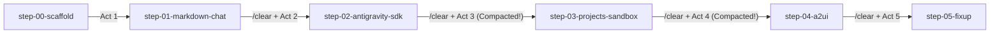

<!-- S01 -->

  <h1 class="text-5xl font-extrabold tracking-tight text-white mb-3">
    Flutter, Antigravity SDK, and GenUI
  </h1>
  

    A vibe coding exploration
  

  

    Brett Morgan &middot; Developer Relations Engineer, Google Cloud
  

  

    Press <kbd>Space</kbd> or <kbd>&rarr;</kbd> to advance
  

<!--
Welcome everyone! When I pitched this talk, I had a simple, slightly mischievous question: what happens if we take Flutter on desktop, the new Google Antigravity SDK, and GenUI, and glue them all together?
-->

---
layout: center
class: text-center
---

<!-- S01a -->

  <h1 class="text-5xl font-extrabold tracking-tight text-white mb-3">
    Flutter, Antigravity SDK, and <del class="text-gray-500 decoration-red-400/80">GenUI</del> A2UI
  </h1>
  

    A vibe coding exploration
  

  

    Brett Morgan &middot; Developer Relations Engineer, Google Cloud
  

  

    package:genui deprecated &rarr; replaced by a2ui_core, a2ui_agent &amp; a2ui_flutter (v1.0)
  

<!--
And then, as happens in software engineering when you live on the bleeding edge, right as I sat down to build the demo I realised package:genui had just been deprecated and replaced by the brand-new A2UI v1.0 packages: a2ui_core, a2ui_agent, and a2ui_flutter. Rather than hiding that behind a polished slide deck, we are going to share the real, unfiltered learning journey — with agy as our accomplice.
-->

---
layout: default
---

<!-- S02 -->

  <h2 class="text-2xl font-bold m-0">The Pitch: What Happens If We Glue Them Together?</h2>

<ol class="space-y-5 text-sm text-gray-200 list-decimal pl-6 mt-6 leading-relaxed">
  <li v-click>
    <strong class="text-white text-base">Flutter (macOS Desktop)</strong>
    <ul class="list-disc pl-5 mt-1.5 space-y-1 text-gray-300">
      <li>Fast, expressive multi-platform UI with sub-second hot-restart during live demos.</li>
      <li>Strict engineering hygiene out of the box with <code class="text-cyan-300">dart analyze</code>, <code class="text-cyan-300">flutter_lints</code>, and widget testing.</li>
    </ul>
  </li>
  <li v-click>
    <strong class="text-white text-base">Google Antigravity (<code class="text-amber-300">agy</code> CLI &amp; <code class="text-amber-300">package:antigravity</code> SDK)</strong>
    <ul class="list-disc pl-5 mt-1.5 space-y-1 text-gray-300">
      <li>Acts as our pair-programming accomplice building the application from the terminal.</li>
      <li>Also runs <em>inside</em> the Flutter app as its live agent backend via <code class="text-amber-300">~/.antigravity/bin/localharness</code>.</li>
    </ul>
  </li>
  <li v-click>
    <strong class="text-white text-base">GenUI &rarr; A2UI v1.0 (<code class="text-emerald-300">a2ui_core</code>, <code class="text-emerald-300">a2ui_agent</code>, <code class="text-emerald-300">a2ui_flutter</code>)</strong>
    <ul class="list-disc pl-5 mt-1.5 space-y-1 text-gray-300">
      <li>Replaces <code class="text-gray-400">package:genui</code> with the modular A2UI v1.0 component catalogue and JSON transport protocol.</li>
      <li>Streams live interactive UI surfaces (<code class="text-emerald-300">A2uiSurface</code>) and two-way RPCs inline alongside standard Markdown.</li>
    </ul>
  </li>
</ol>

<!--
Having an AI accomplice makes intimidating or brand-new APIs approachable, provided we pair that curiosity with real engineering hygiene — linters, formatters, and widget tests that act as sanity-savers and keep us honest. First, we have Flutter on macOS desktop giving us sub-second hot-restart and strict static analysis. Second, we use Google Antigravity twice: both as the agy CLI building the app and as the embedded SDK backend running localharness inside the app. Third, we bring in the brand-new A2UI v1.0 packages to stream live interactive UI surfaces inline with Markdown.
-->

---
layout: default
---

<!-- S03 -->

  <h2 class="text-2xl font-bold m-0">How We Built This: 5 Acts, <code class="text-cyan-300">/clear</code>, and Git Tags</h2>

  Each milestone resets context with <code class="text-amber-300">/clear</code>, verifies <code class="text-cyan-300">dart analyze</code> and <code class="text-cyan-300">flutter test</code>, and ends with a Git tag we can hot-restart into in under a second:

<ol class="space-y-1.5 text-xs text-gray-200 list-decimal pl-6 mb-4 leading-relaxed">
  <li>
    <code class="text-cyan-300 font-semibold">step-00-scaffold</code> &rarr; <code class="text-cyan-300 font-semibold">step-01-markdown-chat</code> &mdash;
    <a href="https://github.com/domesticmouse/agy_genui_demo/blob/main/prompts/01-6ee8f6c2-please-build-a-macos-desktop-markdown-chat.md" target="_blank" class="text-cyan-400 underline hover:text-cyan-300">Session 01 Transcript</a>
    (macOS Markdown Chat UI with <code class="text-gray-300">flutter_markdown_plus</code>)
  </li>
  <li>
    <code class="text-amber-300 font-semibold">step-02-antigravity-sdk</code> &mdash;
    <a href="https://github.com/domesticmouse/agy_genui_demo/blob/main/prompts/02-8f4aafaf-please-add-the-antigravity-package-dependency-and.md" target="_blank" class="text-cyan-400 underline hover:text-cyan-300">Session 02 Transcript</a>
    (Live <code class="text-gray-300">package:antigravity</code> backend &amp; macOS entitlements)
  </li>
  <li>
    <code class="text-emerald-300 font-semibold">step-03-projects-sandbox</code> &mdash;
    <a href="https://github.com/domesticmouse/agy_genui_demo/blob/main/prompts/03-10ad2b6c-please-review-this-program-i-m-interested.md" target="_blank" class="text-cyan-400 underline hover:text-cyan-300">Session 03 Transcript</a>
    (Project workspaces, <code class="text-gray-300">exebox</code> sandbox review UI &amp; compaction #1)
  </li>
  <li>
    <code class="text-purple-300 font-semibold">step-04-a2ui</code> &mdash;
    <a href="https://github.com/domesticmouse/agy_genui_demo/blob/main/prompts/04-ba34877d-please-add-a2ui-core-a2ui-agent-and.md" target="_blank" class="text-cyan-400 underline hover:text-cyan-300">Session 04 Transcript</a>
    (A2UI v1.0 streaming surfaces, package seamlines, forms &amp; RPCs)
  </li>
  <li>
    <code class="text-pink-300 font-semibold">step-05-fixup</code> &mdash;
    <a href="https://github.com/domesticmouse/agy_genui_demo/blob/main/prompts/05-7407df5f-please-review-this-codebase.md" target="_blank" class="text-cyan-400 underline hover:text-cyan-300">Session 05 Transcript</a>
    (Fresh-context codebase audit &amp; end-to-end RPC loop fix)
  </li>
</ol>

<!--
My plan was simple: structure the build into five acts, tag each milestone in Git so we can hot-restart between them in under a second, and run /clear at the end of every act to keep the context window lean and avoid context bloat. Spoiler alert: despite my best intentions, I still got carried away stacking follow-up prompts inside Acts 3 and 4 and got hit by automatic context compaction later in the show!
-->
