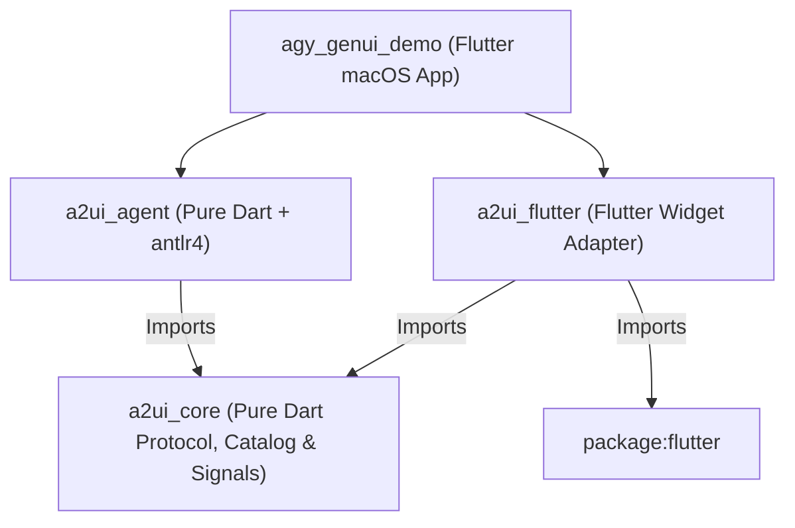
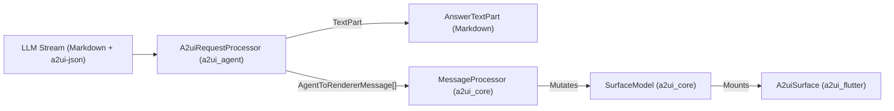
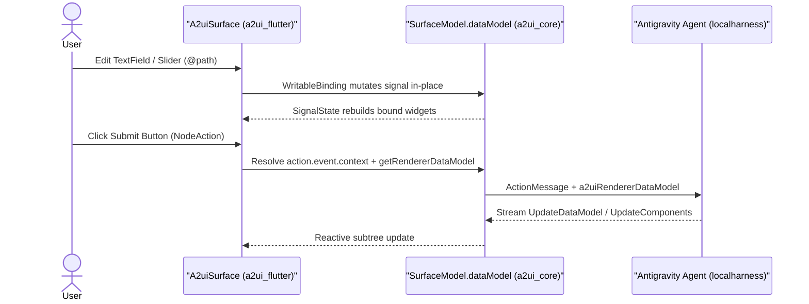

<!-- S21 -->
<div class="space-y-4">
  <h1 class="text-4xl font-extrabold text-white">
    Act 4 &mdash; Generative UI with A2UI v1.0
  </h1>
  <p class="text-xl font-mono text-purple-300">
    a2ui_core &middot; a2ui_agent &middot; a2ui_flutter &middot; step-04-a2ui &middot;
    <a href="https://github.com/domesticmouse/agy_genui_demo/blob/main/prompts/04-ba34877d-please-add-a2ui-core-a2ui-agent-and.md" target="_blank" class="underline hover:text-purple-200">Transcript 04</a>
  </p>
  <p class="text-base text-gray-400 max-w-xl mx-auto">
    Streaming live interactive A2UI v1.0 surfaces inline with Markdown, unpacking the three-package architecture, and wiring bidirectional RPCs.
  </p>
</div>

<!--
Welcome to Act 4! This is where we bring in the brand-new A2UI v1.0 packages — a2ui_core, a2ui_agent, and a2ui_flutter — that just replaced package:genui. We are going to stream live interactive UI surfaces inline with Markdown, ask agy to map out the exact seamlines between the three packages, and implement interactive parameter forms and bidirectional RPCs.
-->

---
layout: skill-breakdown
way: 1
title: "Prompt 4.1 — Add a2ui_core, a2ui_agent, and a2ui_flutter"
---

<!-- S22 -->
<div class="space-y-4 my-auto">
  <div class="text-xs font-mono text-cyan-400 uppercase tracking-wider">
    Inline Generative UI Surfaces (A2UI v1.0)
  </div>

  <div class="space-y-3 font-mono text-sm">
    <div v-click class="p-4 rounded-lg bg-[#0d0e12] border border-cyan-500/30 text-gray-200 leading-relaxed">
      Please add <span class="text-cyan-300 font-semibold">a2ui_core</span>, <span class="text-amber-300 font-semibold">a2ui_agent</span>, and <span class="text-emerald-300 font-semibold">a2ui_flutter</span> to this project
    </div>
    <div v-click class="p-4 rounded-lg bg-[#0d0e12] border border-gray-800 text-gray-200 leading-relaxed">
      and integrate <span class="text-purple-300 font-semibold">A2UI v1.0 surface rendering</span> into the chat UI so <code class="text-cyan-300">&lt;a2ui-json&gt;</code> blocks stream live interactive <code class="text-emerald-300">A2uiSurface</code> widgets inline alongside Markdown.
    </div>
  </div>
</div>

<!--
Here is Prompt 4.1. Remember, a2ui_core, a2ui_agent, and a2ui_flutter had just been published to replace package:genui. We ask agy to add all three dependencies and integrate A2UI v1.0 surface rendering so a2ui-json blocks stream live interactive A2uiSurface widgets right inside our chat bubbles alongside standard Markdown.
-->

---
layout: cast-full
title: "Act 4.1: Streaming a2ui-json Surfaces & Debugging 3 Subtle Bugs"
cast: /casts/04a-act4-a2ui-surfaces.cast
autoPlay: false
speed: 2.0
idleTimeLimit: 2.0
fit: both
---

<!-- S23 -->
<!--
Watch what happens in Clip 4.1. Because these three A2UI packages are brand new, agy inspects every single library export inside ~/.pub-cache/hosted/pub.dev/ across a2ui_core, a2ui_agent, and a2ui_flutter, wires up StreamedAnswer and A2uiSurface, and writes comprehensive widget tests. Exploring all three packages and diagnosing three subtle integration bugs takes over 90 tool calls in a single turn — triggering automatic Conversation compacted even inside a freshly cleared session!
-->

---
layout: default
---

<!-- S24 -->
<div class="flex items-center gap-3 mb-5">
  <h2 class="text-2xl font-bold m-0">3 Real-World A2UI v1.0 Bugs <code class="text-cyan-300">agy</code> Diagnosed During Testing</h2>
</div>

<ol class="space-y-4 text-sm text-gray-200 list-decimal pl-6 mt-4 leading-relaxed">
  <li v-click>
    <strong class="text-white">A2UI v1.0 <code class="text-amber-300">Text.variant</code> Schema Constraint</strong>
    <ul class="list-disc pl-5 mt-1 space-y-1 text-gray-300">
      <li><code class="text-cyan-300">BasicCatalog.v1_0</code> only allows <code class="text-emerald-300">'caption'</code> or <code class="text-emerald-300">'body'</code> (whereas v0.8 allowed <code class="text-red-300">'h5'</code>).</li>
      <li><code class="text-cyan-300">PayloadValidator</code> caught the invalid enum immediately when validating our starter showcase surface during <code class="text-cyan-300">flutter test</code>.</li>
    </ul>
  </li>
  <li v-click>
    <strong class="text-white">Inline Backtick <code class="text-amber-300">&lt;a2ui-json&gt;</code> Tag Collision</strong>
    <ul class="list-disc pl-5 mt-1 space-y-1 text-gray-300">
      <li><code class="text-cyan-300">DirectJsonParser</code> strips backticks around <code class="text-amber-300">`&lt;a2ui-json&gt;`</code> to forgive LLMs that wrap delimiter tags in inline code.</li>
      <li>Mentioning literal <code class="text-red-300">`&lt;a2ui-json&gt;`</code> in Markdown prose opened the JSON block prematurely until escaped or referred to as an <code class="text-emerald-300">a2ui-json</code> block.</li>
    </ul>
  </li>
  <li v-click>
    <strong class="text-white"><code class="text-amber-300">A2uiMarkdown</code> Inside <code class="text-amber-300">OutlinedButton</code> Intercepting Taps</strong>
    <ul class="list-disc pl-5 mt-1 space-y-1 text-gray-300">
      <li>Wrapping <code class="text-cyan-300">A2uiSurface</code> with <code class="text-cyan-300">A2uiMarkdown</code> defaulted button labels to <code class="text-red-300">selectable: true</code> and full-width, swallowing pointer taps in widget tests.</li>
      <li>Fixed by setting <code class="text-emerald-300">selectable: false, fitContent: true</code> in <a href="https://github.com/domesticmouse/agy_genui_demo/blob/main/lib/ui/features/chat/views/widgets/message_bubble.dart" target="_blank" class="text-cyan-400 underline">message_bubble.dart</a>.</li>
    </ul>
  </li>
</ol>

<!--
None of these three bugs were obvious from reading a README. First, A2UI v1.0 tightened Text.variant to only allow caption or body instead of h5, which PayloadValidator caught right away. Second, DirectJsonParser forgivingly strips backticks around a2ui-json tags, so mentioning the tag in inline prose prematurely opened the JSON parser! Third, wrapping A2uiSurface with A2uiMarkdown made button text selectable by default, which intercepted pointer taps on OutlinedButton until agy set selectable: false and fitContent: true. All three were caught and fixed before we ever launched the app because agy wrote widget tests for the streaming surfaces and refused to move on until flutter test was completely green.
-->

---
layout: skill-breakdown
way: 2
title: "Prompt 4.2 — Research the A2UI Package Seamlines"
---

<!-- S25 -->
<div class="space-y-4 my-auto">
  <div class="text-xs font-mono text-amber-400 uppercase tracking-wider">
    Architectural Deep Dive &mdash; 3-Package Separation of Concerns
  </div>

  <div class="space-y-3 font-mono text-sm">
    <div v-click class="p-4 rounded-lg bg-[#0d0e12] border border-amber-500/30 text-gray-200 leading-relaxed">
      Please research the <span class="text-amber-300 font-semibold">seamlines</span> between <code class="text-cyan-300">a2ui_core</code>, <code class="text-amber-300">a2ui_agent</code> and <code class="text-emerald-300">a2ui_flutter</code>.
    </div>
    <div v-click class="p-4 rounded-lg bg-[#0d0e12] border border-gray-800 text-gray-200 leading-relaxed">
      Explain <span class="text-cyan-300 font-semibold">when to use each</span>.
    </div>
  </div>
</div>

<!--
Because a2ui_core, a2ui_agent, and a2ui_flutter had just replaced package:genui, I asked agy to be my research accomplice in Prompt 4.2 and map out the exact architectural seamlines between the three packages and explain when to use each.
-->

---
layout: cast-full
title: "Act 4.2: Researching A2UI Package Seamlines"
cast: /casts/04b-act4-a2ui-seamlines.cast
autoPlay: false
speed: 2.0
idleTimeLimit: 2.0
fit: both
---

<!-- S26 -->
<!--
In Clip 4.2, agy traces the pubspecs, type parameters, and class boundaries across all three packages and synthesises a crystal-clear architectural map. Because that terminal report scrolls by fast, let us take the next seven slides to unpack what agy discovered.
-->

---
layout: default
---

<!-- S27 -->
<div class="flex items-center gap-3 mb-3">
  <h2 class="text-2xl font-bold m-0">Overview (1 of 7): How the 3 A2UI Packages Layer Together</h2>
</div>

<ul class="space-y-1.5 text-xs text-gray-200 list-disc pl-5 mb-3 leading-relaxed">
  <li>
    <strong class="text-cyan-300 font-mono">a2ui_core</strong> <span class="text-gray-400">(Pure Dart foundation):</span> Zero dependency on Flutter or any LLM SDK &mdash; protocol envelopes, catalogue schemas, JSON Pointer data models, and reactive <code class="text-gray-300">preact_signals</code>.
  </li>
  <li>
    <strong class="text-amber-300 font-mono">a2ui_agent</strong> <span class="text-gray-400">(Pure Dart agent bridge):</span> Depends on <code class="text-cyan-300">a2ui_core</code> (and <code class="text-gray-300">antlr4</code>), <strong>never</strong> on <code class="text-gray-300">flutter</code> &mdash; prompt generation, streaming parser, and JSON healing.
  </li>
  <li>
    <strong class="text-emerald-300 font-mono">a2ui_flutter</strong> <span class="text-gray-400">(Flutter widget layer):</span> Depends on <code class="text-cyan-300">a2ui_core</code> and <code class="text-gray-300">flutter</code>, <strong>never</strong> on <code class="text-amber-300">a2ui_agent</code> &mdash; concrete widget catalogue and <code class="text-emerald-300">A2uiSurface</code>.
  </li>
</ul>

<div class="p-3 rounded-xl bg-gray-900/70 border border-gray-800">



</div>

<!--
Here is the big-picture dependency graph. At the foundation sits a2ui_core, which is pure Dart with zero dependency on Flutter or any LLM SDK. Above it sit two sibling packages that never import each other: a2ui_agent is pure Dart for server or client LLM orchestration, and a2ui_flutter is the Flutter widget adapter that only knows about a2ui_core and package:flutter.
-->

---
layout: default
---

<!-- S28 -->
<div class="flex items-center gap-3 mb-4">
  <h2 class="text-2xl font-bold m-0">Package 1 (2 of 7): <code class="text-cyan-300">a2ui_core</code> &mdash; Headless Protocol &amp; Signals</h2>
</div>

<ol class="space-y-3 text-xs text-gray-200 list-decimal pl-6 mt-3 leading-relaxed">
  <li v-click>
    <strong class="text-white text-sm">Wire Protocol &amp; Envelopes</strong>
    <ul class="list-disc pl-5 mt-1 space-y-0.5 text-gray-300">
      <li><code class="text-cyan-300">AgentToRendererMessage</code>: <code class="text-gray-200">CreateSurfaceMessage</code>, <code class="text-gray-200">UpdateComponentsMessage</code>, <code class="text-gray-200">UpdateDataModelMessage</code>, <code class="text-gray-200">DeleteSurfaceMessage</code>, and <code class="text-gray-200">CallRendererFunctionMessage</code>.</li>
      <li><code class="text-amber-300">RendererToAgentMessage</code>: <code class="text-gray-200">ActionMessage</code>, <code class="text-gray-200">ErrorMessage</code>, and <code class="text-gray-200">FunctionResponseMessage</code>.</li>
    </ul>
  </li>
  <li v-click>
    <strong class="text-white text-sm">Catalogue Specification</strong>
    <ul class="list-disc pl-5 mt-1 space-y-0.5 text-gray-300">
      <li>Defines generic <code class="text-cyan-300">Catalog&lt;T extends ComponentApi, F extends FunctionApi&gt;</code> and <code class="text-cyan-300">BasicCatalog.v1_0</code> (JSON Schemas for components + client-side functions like <code class="text-gray-200">formatString</code>, <code class="text-gray-200">required</code>, <code class="text-gray-200">regex</code>).</li>
    </ul>
  </li>
  <li v-click>
    <strong class="text-white text-sm">Message Routing &amp; Validation</strong>
    <ul class="list-disc pl-5 mt-1 space-y-0.5 text-gray-300">
      <li><code class="text-cyan-300">MessageProcessor&lt;T&gt;</code> validates messages against catalogue schemas (<code class="text-gray-200">PayloadValidator</code>) and component graph topology (<code class="text-gray-200">ValidationConfig</code>), applying updates to <code class="text-gray-200">SurfaceGroupModel&lt;T&gt;</code>.</li>
    </ul>
  </li>
  <li v-click>
    <strong class="text-white text-sm">Reactive Surface &amp; Node Resolution</strong>
    <ul class="list-disc pl-5 mt-1 space-y-0.5 text-gray-300">
      <li><code class="text-cyan-300">SurfaceModel&lt;T&gt;</code>, <code class="text-cyan-300">DataModel</code>, <code class="text-cyan-300">GenericBinder</code>, and <code class="text-cyan-300">NodeResolver&lt;T&gt;</code> turn a flat component map and JSON Pointer data model (<code class="text-emerald-300">@path</code>, <code class="text-emerald-300">@call</code>) into a reactive tree of <code class="text-gray-200">ComponentNode&lt;T&gt;</code> backed by <code class="text-gray-200">preact_signals</code>.</li>
    </ul>
  </li>
</ol>

<!--
Let us look at Package 1: a2ui_core. First, it defines the typed wire envelopes in both directions: AgentToRendererMessage and RendererToAgentMessage. Second, it defines the generic Catalog specification and the standard BasicCatalog.v1_0 JSON schemas. Third, MessageProcessor validates incoming envelopes against both the JSON schema and the component graph topology before mutating SurfaceGroupModel. Fourth, SurfaceModel, DataModel, and NodeResolver turn flat component maps and JSON pointer bindings into a live reactive tree backed by preact_signals.
-->

---
layout: default
---

<!-- S29 -->
<div class="flex items-center gap-3 mb-5">
  <h2 class="text-2xl font-bold m-0">Package 2 (3 of 7): <code class="text-amber-300">a2ui_agent</code> &mdash; Prompting, Parsing &amp; JSON Healing</h2>
</div>

<ol class="space-y-4 text-sm text-gray-200 list-decimal pl-6 mt-4 leading-relaxed">
  <li v-click>
    <strong class="text-white">Capability Negotiation (<code class="text-amber-300">A2uiGenerator</code>)</strong>
    <ul class="list-disc pl-5 mt-1 space-y-1 text-gray-300">
      <li>Matches the client's <code class="text-cyan-300">A2uiRendererCapabilities</code> against available <code class="text-cyan-300">CatalogConfig</code>s (optionally pruning unused components via <code class="text-gray-200">PruningTransformer</code>) to construct an <code class="text-amber-300">A2uiRequestProcessor</code>.</li>
    </ul>
  </li>
  <li v-click>
    <strong class="text-white">System Prompt Generation (<code class="text-amber-300">promptSnippet</code>)</strong>
    <ul class="list-disc pl-5 mt-1 space-y-1 text-gray-300">
      <li><code class="text-amber-300">a2uiRequestProcessor.promptSnippet</code> emits the system instructions and <code class="text-gray-200">---BEGIN A2UI JSON SCHEMA---</code> teaching the LLM to output <code class="text-cyan-300">&lt;a2ui-json&gt;</code> (<code class="text-gray-200">DirectJsonFormatFactory</code>) or the compact A2UI Express DSL (<code class="text-gray-200">ExpressFormatFactory</code>).</li>
    </ul>
  </li>
  <li v-click>
    <strong class="text-white">Streaming LLM Parser &amp; JSON Healer</strong>
    <ul class="list-disc pl-5 mt-1 space-y-1 text-gray-300">
      <li><code class="text-amber-300">DirectJsonParser</code> and <code class="text-amber-300">DirectJsonContinuingResponseStream</code> split raw LLM token streams into prose <code class="text-cyan-300">TextPart</code>, healed incremental <code class="text-emerald-300">A2uiPart</code> (<code class="text-gray-200">List&lt;AgentToRendererMessage&gt;</code>), and <code class="text-red-300">ErrorPart</code>.</li>
      <li>Validates against <code class="text-cyan-300">RendererState</code> with automatic transactional rollback if a block fails validation.</li>
    </ul>
  </li>
</ol>

<!--
Package 2 is a2ui_agent. First, A2uiGenerator negotiates capabilities between the client renderer and the available catalogues to build an A2uiRequestProcessor. Second, promptSnippet generates the exact system instructions and JSON schemas that teach the LLM how to emit a2ui-json blocks or the compact Express DSL. Third, as tokens stream back from the LLM, DirectJsonParser separates Markdown prose from a2ui-json blocks, heals incomplete streaming JSON on the fly so UI components appear incrementally, and performs transactional rollback if an LLM block fails validation.
-->

---
layout: default
---

<!-- S30 -->
<div class="flex items-center gap-3 mb-5">
  <h2 class="text-2xl font-bold m-0">Package 3 (4 of 7): <code class="text-emerald-300">a2ui_flutter</code> &mdash; Flutter Widget Adapter</h2>
</div>

<ol class="space-y-4 text-sm text-gray-200 list-decimal pl-6 mt-4 leading-relaxed">
  <li v-click>
    <strong class="text-white">Concrete Component Type (<code class="text-emerald-300">ComponentImplementation</code>)</strong>
    <ul class="list-disc pl-5 mt-1 space-y-1 text-gray-300">
      <li>Subclasses <code class="text-cyan-300">a2ui_core</code>'s <code class="text-cyan-300">ComponentApi</code>, attaching a Flutter <code class="text-emerald-300">ComponentWidgetBuilder</code> (<code class="text-gray-200">Widget Function(BuildContext, ComponentNode, ComponentProps, ChildWidgetBuilder)</code>) to each component's JSON Schema.</li>
    </ul>
  </li>
  <li v-click>
    <strong class="text-white">Flutter Basic Catalogue (<code class="text-emerald-300">basicCatalog()</code>)</strong>
    <ul class="list-disc pl-5 mt-1 space-y-1 text-gray-300">
      <li>Returns a <code class="text-emerald-300">CatalogImplementation</code> (<code class="text-gray-200">Catalog&lt;ComponentImplementation, FunctionImplementation&gt;</code>) implementing all 18 A2UI v1.0 basic components: <code class="text-gray-200">Card</code>, <code class="text-gray-200">Row</code>, <code class="text-gray-200">Column</code>, <code class="text-gray-200">List</code>, <code class="text-gray-200">Tabs</code>, <code class="text-gray-200">Modal</code>, <code class="text-gray-200">Text</code>, <code class="text-gray-200">Image</code>, <code class="text-gray-200">Icon</code>, <code class="text-gray-200">Video</code>, <code class="text-gray-200">AudioPlayer</code>, <code class="text-gray-200">Divider</code>, <code class="text-gray-200">Button</code>, <code class="text-gray-200">TextField</code>, <code class="text-gray-200">CheckBox</code>, <code class="text-gray-200">ChoicePicker</code>, <code class="text-gray-200">Slider</code>, and <code class="text-gray-200">DateTimeInput</code>.</li>
    </ul>
  </li>
  <li v-click>
    <strong class="text-white">Reactive Surface Widget (<code class="text-emerald-300">A2uiSurface</code>)</strong>
    <ul class="list-disc pl-5 mt-1 space-y-1 text-gray-300">
      <li>Takes a <code class="text-cyan-300">SurfaceModel&lt;ComponentImplementation&gt;</code>, attaches a <code class="text-cyan-300">NodeResolver&lt;ComponentImplementation&gt;</code>, and rebuilds only affected widget subtrees via <code class="text-emerald-300">SignalState</code> as signals change.</li>
    </ul>
  </li>
</ol>

<!--
Package 3 is a2ui_flutter. It subclasses a2ui_core's ComponentApi with ComponentImplementation, pairing each JSON Schema with a Flutter ComponentWidgetBuilder. Its basicCatalog function gives you ready-made Material 3 implementations of all 18 A2UI v1.0 basic components, and the A2uiSurface widget mounts any SurfaceModel and granularly rebuilds only the widget subtrees whose signals change.
-->

---
layout: skill-breakdown
way: 1
title: "Seamlines 1 & 2 (5 of 7): Catalogue Type Erasure & Stream Processing"
---

<!-- S31 -->
<div class="space-y-3 text-xs leading-relaxed">
  <div class="grid grid-cols-2 gap-3">
    <div class="p-3 rounded-lg bg-gray-900/80 border border-gray-800 space-y-1">
      <div class="text-cyan-300 font-semibold font-mono">
        Seamline 1: ComponentApi &harr; ComponentImplementation
      </div>
      <ul class="list-disc pl-4 space-y-0.5 text-gray-300">
        <li><code class="text-cyan-300">a2ui_core</code> is generic over <code class="text-gray-200">T extends ComponentApi</code>.</li>
        <li><code class="text-emerald-300">a2ui_flutter</code> provides <code class="text-gray-200">basicCatalog()</code> (<code class="text-gray-200">Catalog&lt;ComponentImplementation, ...&gt;</code>).</li>
        <li><code class="text-amber-300">CatalogConfig.fromCatalog()</code> erases the Flutter widget builder down to <code class="text-gray-200">ComponentApi</code> JSON Schemas so <code class="text-amber-300">a2ui_agent</code> never imports Flutter.</li>
      </ul>
    </div>
    <div class="p-3 rounded-lg bg-gray-900/80 border border-gray-800 space-y-1">
      <div class="text-amber-300 font-semibold font-mono">
        Seamline 2: A2uiRequestProcessor &harr; MessageProcessor&lt;T&gt;
      </div>
      <ul class="list-disc pl-4 space-y-0.5 text-gray-300">
        <li><code class="text-amber-300">A2uiRequestProcessor</code> converts raw LLM chunks (<code class="text-gray-200">&lt;a2ui-json&gt;</code>) &rarr; <code class="text-gray-200">List&lt;AgentToRendererMessage&gt;</code>.</li>
        <li><code class="text-cyan-300">MessageProcessor&lt;T&gt;</code> consumes envelopes &rarr; mutates <code class="text-gray-200">SurfaceModel&lt;T&gt;</code>.</li>
        <li>Can run across a network wire or fused in-process via <code class="text-cyan-300">RendererState.of(renderer)</code> and <code class="text-emerald-300">StreamedAnswer</code>.</li>
      </ul>
    </div>
  </div>

  <div class="p-2.5 rounded-xl bg-gray-900/70 border border-gray-800">



  </div>
</div>

<!--
Now look at Seamlines 1 and 2. Seamline 1 is how a single catalogue feeds both the LLM prompt generator and the Flutter widget tree: CatalogConfig.fromCatalog erases the Flutter widget builder down to pure JSON Schemas so a2ui_agent never touches Flutter. Seamline 2 is the boundary between A2uiRequestProcessor and MessageProcessor: A2uiRequestProcessor turns raw LLM text chunks into typed AgentToRendererMessage envelopes, and MessageProcessor applies them to SurfaceModel. Those two processors can sit on opposite sides of a WebSocket, or be fused in-process via StreamedAnswer!
-->

---
layout: skill-breakdown
way: 2
title: "Seamlines 3 & 4 (6 of 7): Reactive Surface Mounting & Two-Way Actions"
---

<!-- S32 -->
<div class="space-y-2.5 text-xs leading-relaxed">
  <div class="grid grid-cols-2 gap-3">
    <div class="p-2.5 rounded-lg bg-gray-900/80 border border-gray-800 space-y-1">
      <div class="text-emerald-300 font-semibold font-mono">
        Seamline 3: SurfaceModel &harr; A2uiSurface
      </div>
      <p class="text-gray-300 m-0">
        <code class="text-cyan-300">AnswerSurfacePart.surface</code> yields a <code class="text-gray-200">SurfaceModel&lt;ComponentImplementation&gt;</code> passed directly to <code class="text-emerald-300">A2uiSurface(key: ObjectKey(surface), surface: surface)</code>, wrapped in <code class="text-gray-200">A2uiMarkdown</code> for rich text.
      </p>
    </div>
    <div class="p-2.5 rounded-lg bg-gray-900/80 border border-gray-800 space-y-1">
      <div class="text-amber-300 font-semibold font-mono">
        Seamline 4: WritableBinding vs. ActionMessage
      </div>
      <p class="text-gray-300 m-0">
        Editing <code class="text-gray-200">@path</code> inputs mutates <code class="text-cyan-300">SurfaceModel.dataModel</code> locally via <code class="text-gray-200">WritableBinding</code>; clicking a <code class="text-gray-200">Button</code> emits <code class="text-amber-300">ActionMessage</code> + <code class="text-gray-200">getRendererDataModel</code> (plus <code class="text-gray-200">outboundListener</code> for RPCs).
      </p>
    </div>
  </div>

  <div class="p-2 rounded-xl bg-gray-900/70 border border-gray-800">



  </div>
</div>

<!--
Seamlines 3 and 4 show what happens once a surface is mounted on screen. Seamline 3 passes the reactive SurfaceModel straight into A2uiSurface. Seamline 4 distinguishes local data bindings from agent actions: when a user types into a TextField or drags a Slider bound to a JSON Pointer path, WritableBinding mutates the signal in-place in a2ui_core with zero network round-trips. Only when the user clicks a Button with a NodeAction does the renderer resolve the action context, attach getRendererDataModel, and dispatch an ActionMessage back to the agent!
-->

---
layout: default
---

<!-- S33 -->
<div class="flex items-center gap-3 mb-4">
  <h2 class="text-2xl font-bold m-0">When to Use Each Package (7 of 7): 4 Architecture Topologies</h2>
</div>

<ol class="space-y-3.5 text-xs text-gray-200 list-decimal pl-6 mt-3 leading-relaxed">
  <li v-click>
    <strong class="text-white text-sm">Full-Stack / Local Agent Flutter App (<code class="text-cyan-300">agy_genui_demo</code>)</strong> &mdash; <code class="text-cyan-300">a2ui_core</code> + <code class="text-amber-300">a2ui_agent</code> + <code class="text-emerald-300">a2ui_flutter</code>
    <ul class="list-disc pl-5 mt-1 text-gray-300">
      <li>App both prompts/streams from the LLM (<code class="text-amber-300">StreamedAnswer</code>) and renders interactive <code class="text-emerald-300">A2uiSurface</code> widgets over shared in-memory <code class="text-cyan-300">SurfaceModel</code> state.</li>
    </ul>
  </li>
  <li v-click>
    <strong class="text-white text-sm">Thin Flutter Client + Remote Backend Agent</strong> &mdash; <code class="text-cyan-300">a2ui_core</code> + <code class="text-emerald-300">a2ui_flutter</code> <span class="text-gray-400">(No <code class="text-amber-300">a2ui_agent</code> on client)</span>
    <ul class="list-disc pl-5 mt-1 text-gray-300">
      <li>Backend server parses LLM output and streams <code class="text-cyan-300">AgentToRendererMessage</code>s over WebSockets/SSE/gRPC directly into the client's <code class="text-cyan-300">MessageProcessor&lt;ComponentImplementation&gt;</code>.</li>
    </ul>
  </li>
  <li v-click>
    <strong class="text-white text-sm">Dart Backend Agent Server / CLI (<code class="text-gray-300">shelf</code>, <code class="text-gray-300">dart_frog</code>, CLI)</strong> &mdash; <code class="text-cyan-300">a2ui_core</code> + <code class="text-amber-300">a2ui_agent</code> <span class="text-gray-400">(No <code class="text-emerald-300">a2ui_flutter</code>)</span>
    <ul class="list-disc pl-5 mt-1 text-gray-300">
      <li>Pure Dart server cannot depend on <code class="text-gray-300">flutter</code>; uses <code class="text-cyan-300">BasicCatalog.v1_0()</code> + <code class="text-amber-300">A2uiRequestProcessor</code> + <code class="text-cyan-300">RendererState</code> to prompt the LLM, heal/validate <code class="text-gray-200">&lt;a2ui-json&gt;</code>, and forward envelopes to clients.</li>
    </ul>
  </li>
  <li v-click>
    <strong class="text-white text-sm">Custom Non-Flutter Dart Renderer / Headless Testing</strong> &mdash; <code class="text-cyan-300">a2ui_core</code> <span class="text-gray-400">(+ optional <code class="text-amber-300">a2ui_agent</code>)</span>
    <ul class="list-disc pl-5 mt-1 text-gray-300">
      <li>Subclass <code class="text-cyan-300">ComponentApi</code> and mount <code class="text-cyan-300">NodeResolver&lt;MyComponent&gt;</code> to target Jaspr, terminal UI, or headless unit tests.</li>
    </ul>
  </li>
</ol>

<!--
That clean separation gives you four distinct architecture topologies. First, a full-stack or local-agent Flutter app like our demo uses all three packages together. Second, a thin Flutter mobile or desktop client talking to a remote backend only needs a2ui_core and a2ui_flutter. Third, a pure Dart backend server built with shelf or dart_frog cannot import Flutter, so it pairs a2ui_core with a2ui_agent to generate prompts, heal streaming JSON, and validate envelopes on the server. Fourth, if you are building a non-Flutter Dart renderer like Jaspr or running headless tests, you can build directly on a2ui_core.
-->

---
layout: skill-breakdown
way: 3
title: "Prompt 4.3 — Explore Capabilities for This Codebase"
---

<!-- S34 -->
<div class="space-y-4 my-auto">
  <div class="text-xs font-mono text-emerald-400 uppercase tracking-wider">
    Brainstorming Concrete A2UI Enhancements with agy
  </div>

  <div v-click class="p-4 rounded-lg bg-[#0d0e12] border border-emerald-500/40 font-mono text-base text-emerald-200">
    Give me some options for utilising this capability in the current codebase
  </div>

  <p class="text-xs text-gray-400 pt-2">
    With the three-package architecture loaded in context, we ask <code class="text-cyan-300">agy</code> to propose concrete ways to exploit A2UI v1.0 inside our desktop app.
  </p>
</div>

<!--
Now that both we and agy have the full three-package architecture loaded in context, we send Prompt 4.3: Give me some options for utilising this capability in the current codebase.
-->

---
layout: cast-full
title: "Act 4.3: Brainstorming 6 A2UI Enhancements"
cast: /casts/04c-act4-a2ui-options.cast
autoPlay: false
speed: 2.0
idleTimeLimit: 2.0
fit: both
---

<!-- S35 -->
<!--
In Clip 4.3, agy inspects what our codebase already wires up versus what A2UI v1.0 is capable of, and proposes six concrete options tailored to this application. Let us walk through all six suggestions across the next three slides.
-->

---
layout: default
---

<!-- S36 -->
<div class="flex items-center gap-3 mb-5">
  <h2 class="text-2xl font-bold m-0"><code class="text-cyan-300">agy</code>'s Suggestions (1 of 3): Action Loops &amp; Developer Catalogue</h2>
</div>

<ol class="space-y-5 text-sm text-gray-200 list-decimal pl-6 mt-4 leading-relaxed">
  <li v-click>
    <strong class="text-white text-base">Option 1: Live Two-Way Action Loop (<code class="text-cyan-300">Button</code> &rarr; Agent Turn + <code class="text-cyan-300">a2uiRendererDataModel</code> Sync)</strong>
    <ul class="list-disc pl-5 mt-1.5 space-y-1 text-gray-300">
      <li>Automatically dispatch <code class="text-cyan-300">ActionMessage</code> + <code class="text-cyan-300">a2uiRendererDataModel</code> to the thread's Antigravity <code class="text-amber-300">Agent</code> when a user clicks an <code class="text-emerald-300">A2uiSurface</code> <code class="text-gray-200">Button</code>.</li>
      <li>Show a compact user "Action Pill" in the chat feed (e.g., <code class="text-amber-300">Action: book_flight (destination: Kyoto)</code>) and let the agent mutate the existing surface in-place via <code class="text-gray-200">updateDataModel</code> / <code class="text-gray-200">updateComponents</code>.</li>
      <li>Attach <code class="text-gray-200">renderer.getRendererDataModel(version: A2uiProtocolVersion.v1_0)</code> to regular text prompts when active surfaces have <code class="text-emerald-300">sendDataModel: true</code>.</li>
    </ul>
  </li>
  <li v-click>
    <strong class="text-white text-base">Option 2: Custom Workspace &amp; Developer Catalogue (<code class="text-emerald-300">CatalogImplementation</code> Extensions)</strong>
    <ul class="list-disc pl-5 mt-1.5 space-y-1 text-gray-300">
      <li><code class="text-cyan-300">CodeDiffCard</code>: Side-by-side or unified diff preview with <strong>Apply Patch</strong> / <strong>Discard</strong> action buttons.</li>
      <li><code class="text-cyan-300">FileTreeCard</code> / <code class="text-cyan-300">WorkspaceFileCard</code>: Clickable file badges (<code class="text-gray-200">path</code>, <code class="text-gray-200">lineStart</code>, <code class="text-gray-200">lineEnd</code>, <code class="text-gray-200">summary</code>) for files in <code class="text-gray-200">ChatProject.workingDirectory</code>.</li>
      <li><code class="text-cyan-300">CommandRunnerCard</code>: Proposes a shell command with editable flags (<code class="text-gray-200">TextField</code> / <code class="text-gray-200">CheckBox</code> bound to data model) and a <strong>Run in Workspace</strong> button.</li>
    </ul>
  </li>
</ol>

<!--
Here are Options 1 and 2 from agy. Option 1 is closing the two-way action loop so clicking a Button on an A2uiSurface sends an ActionMessage and the current surface data model back to the Antigravity agent, letting the agent update the surface in-place. Option 2 is extending CatalogImplementation with custom developer widgets like a CodeDiffCard, WorkspaceFileCard, or CommandRunnerCard with editable flags.
-->

---
layout: default
---

<!-- S37 -->
<div class="flex items-center gap-3 mb-5">
  <h2 class="text-2xl font-bold m-0"><code class="text-cyan-300">agy</code>'s Suggestions (2 of 3): Persistent Canvas &amp; Self-Healing</h2>
</div>

<ol start="3" class="space-y-5 text-sm text-gray-200 list-decimal pl-6 mt-4 leading-relaxed">
  <li v-click>
    <strong class="text-white text-base">Option 3: Persistent Split-Pane "Surface Canvas" Drawer (Alongside Inline Chat Surfaces)</strong>
    <ul class="list-disc pl-5 mt-1.5 space-y-1 text-gray-300">
      <li><code class="text-cyan-300">RendererState</code> supports two UX modes over the same <code class="text-cyan-300">MessageProcessor</code>: inline chat turns and a persistent canvas where multi-turn prompts iteratively evolve a single surface.</li>
      <li>Add a toggleable right-hand <strong>A2UI Inspector / Canvas</strong> pane in <code class="text-gray-200">ChatScreen</code> and <code class="text-gray-200">TopToolbar</code>.</li>
      <li>Pin any active surface from <code class="text-gray-200">renderer.model.allSurfaces</code> with a live <strong>Data Model JSON Inspector</strong> (<code class="text-gray-200">surface.dataModel</code>) and <strong>Component Tree Viewer</strong> to watch <code class="text-emerald-300">@path</code> bindings mutate in real time.</li>
    </ul>
  </li>
  <li v-click>
    <strong class="text-white text-base">Option 4: Self-Healing Validation Loop (Automatic LLM Repair on <code class="text-red-300">AnswerErrorPart</code>)</strong>
    <ul class="list-disc pl-5 mt-1.5 space-y-1 text-gray-300">
      <li>When the LLM emits a malformed <code class="text-gray-200">&lt;a2ui-json&gt;</code> block or violates a component schema, <code class="text-emerald-300">StreamedAnswer</code> rolls back that block and <code class="text-gray-200">MessageBubble</code> displays <code class="text-red-300">_InlineA2uiErrorBanner</code>.</li>
      <li>Add a <strong>Fix Surface</strong> button on <code class="text-red-300">_InlineA2uiErrorBanner</code> (or automatic 1-retry self-repair in <code class="text-gray-200">ChatViewModel</code>) that sends <code class="text-amber-300">ErrorMessage(version: '1.0', error: ...)</code> back to the Antigravity session so the agent repairs the surface automatically.</li>
    </ul>
  </li>
</ol>

<!--
Options 3 and 4 go even deeper. Option 3 takes advantage of the fact that RendererState supports a persistent split-pane Surface Canvas alongside inline chat bubbles, complete with a live Data Model JSON inspector so you can watch @path signals mutate as you type. Option 4 wires up a self-healing validation loop: whenever StreamedAnswer rolls back an invalid block and emits an AnswerErrorPart, the app sends an A2UI ErrorMessage straight back to the agent so it can repair its own surface.
-->

---
layout: default
---

<!-- S38 -->
<div class="flex items-center gap-3 mb-5">
  <h2 class="text-2xl font-bold m-0"><code class="text-cyan-300">agy</code>'s Suggestions (3 of 3): Clarification Forms, Express DSL &amp; RPCs</h2>
</div>

<ol start="5" class="space-y-5 text-sm text-gray-200 list-decimal pl-6 mt-4 leading-relaxed">
  <li v-click>
    <strong class="text-white text-base">Option 5: Agent-Driven Clarification Forms ("Ask Question" Surface Pattern)</strong>
    <ul class="list-disc pl-5 mt-1.5 space-y-1 text-gray-300">
      <li>Instead of asking plain-text clarifying questions before writing code or running tools, the agent streams an interactive A2UI v1.0 parameter form (<code class="text-emerald-300">ChoicePicker</code> chips/checkboxes, <code class="text-emerald-300">TextField</code> with validation <code class="text-gray-200">checks</code>, <code class="text-emerald-300">CheckBox</code>, <code class="text-emerald-300">Slider</code>, and a validation-gated <code class="text-cyan-300">Submit</code> <code class="text-gray-200">Button</code>).</li>
      <li>Submitting the form sends the resolved JSON context + data model straight back to the agent.</li>
    </ul>
  </li>
  <li v-click>
    <strong class="text-white text-base">Option 6: A2UI Express Format Toggle &amp; Bidirectional RPCs (<code class="text-amber-300">FunctionImplementation</code>)</strong>
    <ul class="list-disc pl-5 mt-1.5 space-y-1 text-gray-300">
      <li>Switch between <code class="text-gray-200">&lt;a2ui-json&gt;</code> (<code class="text-gray-200">DirectJsonFormatFactory</code>) and the compact token-saving <code class="text-gray-200">&lt;a2ui-express&gt;</code> DSL (<code class="text-gray-200">ExpressFormatFactory</code>) over the exact same <code class="text-emerald-300">StreamedAnswer</code> and <code class="text-cyan-300">MessageProcessor</code> pipeline.</li>
      <li>Register custom <code class="text-amber-300">FunctionImplementation</code>s (<code class="text-cyan-300">AllowedCallers.rendererOrAgent</code>) so the agent and renderer can invoke functions (<code class="text-amber-300">callRendererFunction</code> / <code class="text-amber-300">callAgentFunction</code>) across the wire.</li>
    </ul>
  </li>
</ol>

<!--
And here are Options 5 and 6! Option 5 teaches the agent to stream interactive A2UI v1.0 clarifying forms — with ChoicePicker chips, validated TextFields, Sliders, and a validation-gated Submit button — whenever a prompt has multiple valid interpretations. Option 6 introduces custom FunctionImplementations registered with AllowedCallers.rendererOrAgent so the agent can invoke client-side Dart functions via callRendererFunction and receive a structuredRendererFunctionResponseMessage! We loved Options 5 and 6 so much that we asked agy to build both of them right on the spot.
-->

---
layout: skill-breakdown
way: mashup
title: "Prompt 4.4 — Clarifying Parameter Forms & Bidirectional RPCs"
---

<!-- S39a -->
<div class="space-y-3 text-sm leading-relaxed my-auto">
  <div class="p-3 rounded-lg bg-[#0d0e12] border border-purple-500/30 font-mono text-purple-200">
    Please implement:
  </div>

  <div class="space-y-2.5 font-mono text-gray-200 pl-2">
    <div v-click class="p-3.5 rounded-lg bg-gray-900/80 border border-cyan-500/30">
      <span class="text-cyan-400 font-bold">-</span> Interactive Clarifying Questions &amp; Parameter Forms (<span class="text-cyan-300 font-semibold">Basic Catalog</span>)
    </div>
    <div v-click class="p-3.5 rounded-lg bg-gray-900/80 border border-amber-500/30">
      <span class="text-amber-400 font-bold">-</span> Bidirectional Renderer RPC Functions (<code class="text-amber-300 font-semibold">FunctionImplementation</code>)
    </div>
  </div>
</div>

<!--
Prompt 4.4 is short and sweet: Please implement Interactive Clarifying Questions and Parameter Forms using the Basic Catalog, and Bidirectional Renderer RPC Functions using FunctionImplementation.
-->

---
layout: skill-breakdown
way: mashup
title: "Prompt 4.5 — Tag step-04-a2ui & Reset Context"
---

<!-- S39b -->
<div class="space-y-4 my-auto">
  <div class="text-xs font-mono text-purple-400 uppercase tracking-wider">
    Commit Milestone &amp; Reset Session Context
  </div>

  <div class="space-y-3 font-mono text-sm">
    <div v-click class="p-3.5 rounded-lg bg-[#0d0e12] border border-gray-800 text-gray-200">
      <span class="text-purple-400 font-semibold">Prompt: </span>git commit and tag as step-04-a2ui
    </div>
    <div v-click class="p-3.5 rounded-lg bg-[#0d0e12] border border-amber-500/40 text-amber-300">
      <span class="text-gray-400 font-semibold">Slash command: </span>/clear
    </div>
  </div>

  <p class="text-xs text-gray-400 pt-2">
    Tags the A2UI v1.0 surfaces, clarifying forms, and custom <code class="text-amber-300">FunctionImplementation</code> RPCs at <code class="text-purple-300">step-04-a2ui</code> before clearing for our final Act 5 codebase audit.
  </p>
</div>

<!--
Followed by Prompt 4.5 to commit and tag step-04-a2ui and run /clear before Act 5.
-->

---
layout: cast-full
title: "Act 4.4: Implementing Parameter Forms & Custom FunctionImplementations"
cast: /casts/04d-act4-forms-and-rpcs.cast
autoPlay: false
speed: 2.0
idleTimeLimit: 2.0
fit: both
---

<!-- S40 -->
<!--
In Clip 4.4, agy builds lib/data/catalog/renderer_rpc_functions.dart with four custom FunctionImplementations registered with AllowedCallers.rendererOrAgent: getWorkspaceInfo, listWorkspaceFiles, setSurfaceData, and formatParameterSummary. It also wires up outboundListener on the thread's MessageProcessor, adds starter threads showcasing both clarifying parameter forms and bidirectional RPCs, runs all 17 widget tests to green, and tags step-04-a2ui.
-->

---
layout: hardware-callout
title: "Live Demo — step-04-a2ui"
image: /images/step-04-a2ui.png
imageCaption: "Tag: step-04-a2ui · Inline A2UI v1.0 Surface & ChoicePicker"
---

<!-- S41 -->
<div class="space-y-2.5">
  <div class="flex items-center justify-between">
    <span class="text-xs font-mono uppercase tracking-wider text-purple-400">Git Tag Milestone</span>
    <code class="text-xs font-mono px-2 py-0.5 rounded bg-purple-950/60 border border-purple-500/40 text-purple-200">step-04-a2ui</code>
  </div>

```bash
git clean -fd lib test && git checkout step-04-a2ui -- lib test
# Press 'R' (Hot Restart) in flutter run!
```

  <div class="text-xs text-gray-300 space-y-1 pt-0.5">
    <div class="font-semibold text-white">What to Explore Live:</div>
    <ul class="list-disc pl-4 space-y-1 text-gray-300">
      <li>Send <code class="text-cyan-300">Please give me a multi-choice question</code> &rarr; streams an inline <code class="text-emerald-300">A2uiSurface</code> trivia card (<code class="text-gray-200">ChoicePicker</code> chips + validation-gated <code class="text-gray-200">Submit Answer</code> button).</li>
      <li>Custom RPCs in <a href="https://github.com/domesticmouse/agy_genui_demo/blob/main/lib/data/catalog/renderer_rpc_functions.dart" target="_blank" class="text-cyan-400 underline">renderer_rpc_functions.dart</a> (<code class="text-amber-300">getWorkspaceInfo</code>, <code class="text-amber-300">listWorkspaceFiles</code>).</li>
    </ul>
  </div>

  <div class="p-2.5 rounded-lg bg-amber-950/30 border border-amber-500/40 text-xs text-amber-200">
    <strong class="text-amber-300">Cliffhanger into Act 5:</strong> Click <code class="text-white">Submit Answer</code> right now at <code class="text-purple-300">step-04-a2ui</code> &mdash; it records the action pill locally, <em>but doesn't send a turn back to <code class="text-amber-300">localharness</code> yet!</em> Why? Let's ask a fresh session of <code class="text-cyan-300">agy</code> to audit the codebase in Act 5!
  </div>
</div>

<!--
Let us hot-restart into step-04-a2ui! We can ask the agent: Please give me a multi-choice question, and watch it stream a live interactive A2UI v1.0 Computer History Trivia surface with ChoicePicker chips and a validation-gated Submit Answer button. But here is our cliffhanger into Act 5: watch what happens when we select an answer and click Submit Answer right now at step-04-a2ui. It records the action pill locally in the UI, but it does not send a turn back to localharness yet! Why? Let us ask a fresh session of agy to review the entire codebase in Act 5 and find out!
-->
